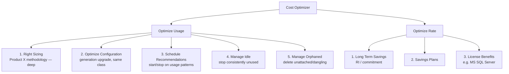
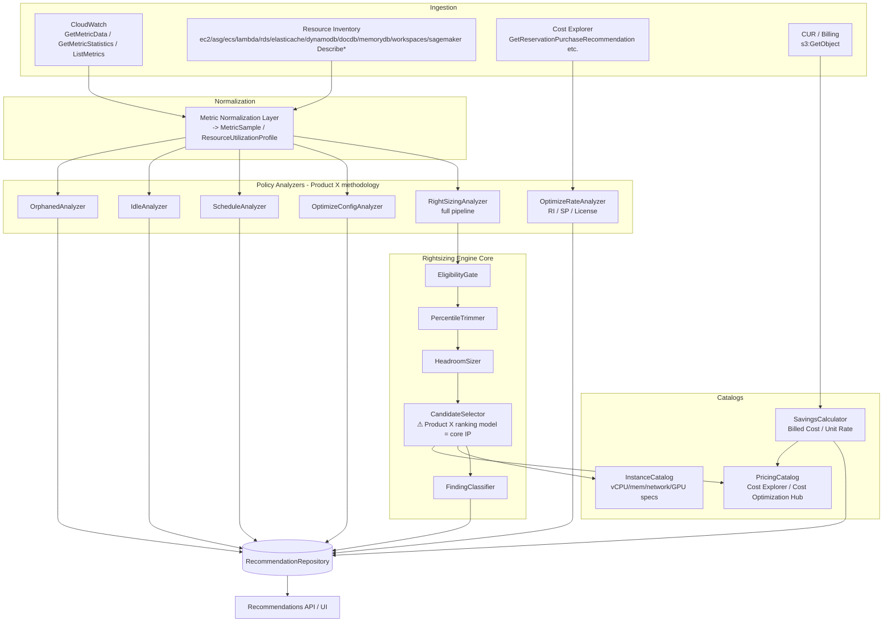
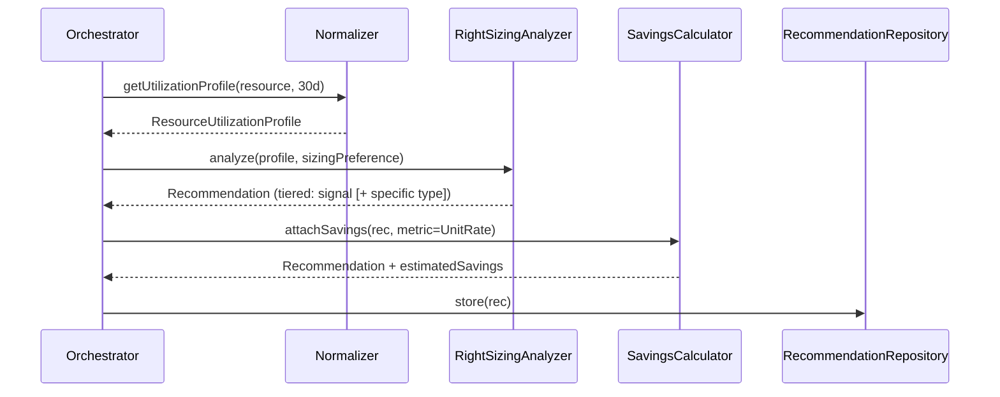
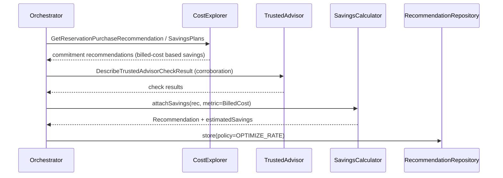

# Design Document: Product X Cost Optimization Engine

**How to read this document.** It is organized **resource-first**. Part I gives the product model and vocabulary, Part II is the authoritative "what we cover" matrix, Part III defines the shared engine machinery **once**, and Part IV contains one **self-contained recipe per resource** that references Part III instead of repeating it. Part V covers the account-level (Optimize Rate) policies, which are not per-resource. Part VI holds cross-cutting concerns (IAM, data models, error handling, testing, correctness properties, dependencies).

---

# Part I — Product Overview & Taxonomy

## Overview

Product X ships a **Cost Optimizer** feature built on its own cost-optimization taxonomy. It analyzes a client's cloud environment and produces cost-savings recommendations organized into two branches: **Optimize Usage** (change what you run) and **Optimize Rate** (change what you pay for what you run).

Product X runs its own proprietary **Cost Optimization Engine** (the "Product X methodology"). On onboarding and on every run, the engine **collects metrics itself** — from CloudWatch and the client's resource inventory — builds utilization profiles over a configurable lookback window, and applies its own policies to generate findings and recommendations. There is no dependency on any external recommendation service being enabled, no enrollment check, and no external recommendation corpus to read: Product X always computes findings from the metrics it collects.

The methodology is **informed by publicly documented AWS Compute Optimizer behavior** — industry-standard sizing techniques such as metric sampling, percentile trimming, growth headroom, eligibility gates, the findings taxonomy, and savings math are drawn from the public [AWS Compute Optimizer User Guide](#[[file:compute-optimizer.pdf]]) as a reference for sound engineering practice. But AWS Compute Optimizer is **not a component, dependency, or data source** of this system; every stage runs on Product X's own implementation over Product X-collected metrics.

The **rightsizing analyzer** is the deepest and most fully specified part of this design, but it is one capability within Product X's larger taxonomy. The other policies (Optimize Configuration, Schedule, Idle, Orphaned, and the three Optimize Rate policies) are specified at a solid design level — data source, detection logic, savings metric, and output — and reuse the same ingestion, eligibility, and savings machinery. In this document the rightsizing pipeline lives in Part III (shared mechanics) and is applied per resource in Part IV.

**The candidate-ranking model is Product X's core IP.** The rightsizing candidate *pipeline* is well understood as industry practice: a consideration-set filter, a supported-type list, Spot exclusion, a per-specification **performance-risk scoring model** (an individual risk score for CPU, memory, EBS throughput, EBS IOPS, disk throughput, disk IOPS, network throughput, and network PPS, aggregated as the **maximum** across specifications, on a very-low..very-high / **0–4** scale), ranked **migration-effort** tiers (very low / low / medium / high, driven by CPU-architecture change and inferred workload), and the savings math (On-Demand and after-discount monthly savings plus a savings-opportunity percentage). The engine surfaces the **top 3** options per resource. The proprietary piece is Product X's **Step 4 candidate-ranking model** — how it trades off cost vs performance-risk vs migration-effort to order those top-3 options. That model is validated against Product X's own benchmark and labeled datasets, not against any external service's output.

The design is governed by these locked decisions:

1. **Full taxonomy coverage** — the engine covers both the Optimize Usage and Optimize Rate branches, not just rightsizing.
2. **Proprietary Product X engine** — Product X always runs its own methodology to generate findings and recommendations from metrics it collects itself. There is no external recommendation source and no fallback routing.
3. **Tiered output** — always emit a **signal** (finding classification plus target capacity), and additionally emit a **specific ranked instance type/size** (with projected utilization and estimated savings) when data quality/confidence is sufficient.
4. **Read-only, detection-only** — the engine runs under a read-only IAM role. It detects and recommends; it never remediates. Remediation (stop/delete/resize) runs under a separate write role and is out of scope (see Scope & Non-Goals).
5. **30-day default lookback** — Product X uses a 30-day default metric-analysis window (configurable), deliberately longer than the 14-day default common in industry tooling, to capture monthly workload cycles and reduce false positives.

---

## Product Model: Cost Optimizer Taxonomy

This is the **product model** — the vocabulary of policies the engine speaks. It says *what kinds of savings* exist and *which cost metric* each kind uses. It deliberately does **not** describe detection mechanics: the detailed, per-resource mechanics live in **Part IV — Per-Resource Recipes**, and the machinery they share lives in **Part III — Shared Engine Mechanics**.



| Branch | Policy | What it evaluates | Primary savings metric |
|---|---|---|---|
| Optimize Usage | Right Sizing | Instance selection vs actual usage; recommend the right instance | Unit Rate |
| Optimize Usage | Optimize Configuration | Config/generation change without changing hardware class (e.g. M3→M4) | Unit Rate |
| Optimize Usage | Schedule | Start/stop VMs based on consistent no-usage time windows | Billed Cost |
| Optimize Usage | Manage Idle | Stop/shutdown resources consistently unused | Billed Cost |
| Optimize Usage | Manage Orphaned | Delete unattached / dangling resources (e.g. unattached EBS) | Billed Cost |
| Optimize Rate | Long Term Savings | RI/commitment recommendations | Billed Cost (Cost Explorer) |
| Optimize Rate | Savings Plans | Savings Plans commitment recommendations | Billed Cost (Cost Explorer) |
| Optimize Rate | License Benefits | Commercial software license optimization | Unit Rate / Billed Cost |

The savings-metric column is governed by **Part III — Cost Savings Calculation Logic**. The five Optimize Usage policies are applied **per resource** (Part IV); the three Optimize Rate policies are applied **per account/commitment** (Part V).

---

## Scope & Non-Goals

**In scope:**

- All eight policies in the taxonomy above.
- Product X's own methodology computing findings from Product X-collected metrics for every resource/policy.
- Tiered output for rightsizing (signal always; specific ranked type when confidence is FULL).
- Detection and recommendation only.

**Out of scope (explicit):**

- **Remediation / write actions.** This engine runs under an entirely read-only IAM role (Describe / Get / List only). Any action that changes cloud state — stopping an instance, deleting a volume, resizing, purchasing an RI or Savings Plan — is performed by a **separate write role** and is **out of scope for this document**. This design is a detection/recommendation engine; it produces recommendations that a downstream remediation component (with its own write permissions and approval workflow) may act on.
- **Recommendation of scaling-policy or capacity-setting changes** for Auto Scaling groups (the rightsizing methodology recommends instance types, not scaling-policy changes).

---

# Part II — Resource Coverage Matrix

This is the single authoritative answer to "what does the engine cover?". Rows are resource types; columns are the Optimize Usage policies that apply, plus the collection constants. Every row has a corresponding recipe in Part IV.

**Part II has two halves.** The **coverage matrix** below answers *which policies apply to a resource type*. The **Supported Resources & Exclusions** reference that follows it answers *which specific types, families, and configurations within a covered resource type are actually eligible*. A resource must clear both to receive a recommendation.

**Optimize Rate is not in this matrix.** Long Term Savings, Savings Plans, and License Benefits are evaluated at the **account / commitment** level, not per resource — see **Part V**. (License Benefits is the one Optimize Rate policy that reads a per-instance metric, but its finding and savings are license-level.)

| Resource type | Right Sizing | Optimize Configuration | Schedule | Manage Idle | Manage Orphaned | Capability tier | Lookback (default / extended) | CloudWatch Period |
|---|---|---|---|---|---|---|---|---|
| **EC2 instance** | ✅ CPU, memory, network, GPU | ✅ same-class generation upgrade | ✅ hour-of-week histogram | ✅ non-GPU + GPU criteria | — | Sizing + Idle | 30d / 93d | 300s |
| **EC2 Auto Scaling group** | ✅ CPU, memory, network | ✅ new-generation type suggestion | — | ✅ all-members criteria | — | Sizing + Idle | 30d / 93d | 300s |
| **EBS volume** | ✅ IOPS, throughput, size | — | — | ✅ attached, non-root, < 1 op/day | ✅ unattached ≥ **32d** | Sizing + Idle | 30d / 93d (unattached: 32d) | 300s |
| **ECS service on Fargate** | ✅ CPU, memory (task + container) | — | — | ✅ CPU **and** memory < 1% | — | Sizing + Idle | 30d / 93d | **60s** |
| **Lambda function** | ✅ memory (drives CPU) | — | — | — ¹ | — | Sizing (fully-modeled) | 30d / 93d | 300s |
| **RDS / Aurora databases** | — | — | — | ✅ | — | Idle-only | 30d | 300s |
| **NAT Gateway** | — | — | — | ✅ | — | Idle-only | 30d | 300s |
| **DynamoDB (provisioned)** | — | — | — | ✅ table + all GSI levels | — | Idle-only | 30d | 300s |
| **ElastiCache (Redis/Valkey)** | — | — | — | ✅ node-level, all nodes idle | — | Idle-only | 30d | 300s |
| **MemoryDB** | — | — | — | ✅ cluster must be `available` | — | Idle-only | 30d | 300s |
| **DocumentDB** | — | — | — | ✅ elastic clusters excluded | — | Idle-only | 30d | 300s |
| **WorkSpaces (Always On)** | — | — | — | ✅ no user connection | — | Idle-only | **63d** | 300s |
| **SageMaker endpoints** | — | — | — | ✅ zero invocations | — | Idle-only | 30d | 300s |

¹ Lambda sits in the fully-modeled tier (it runs the sizing pipeline with an eligibility gate and a findings taxonomy), but **no idle criterion is documented for Lambda** — it is not evaluated by the Idle policy.

### Legend & scope note (the two tiers)

- **Sizing + Idle (fully-modeled tier)** — EC2 instance, EC2 Auto Scaling group, EBS volume, ECS service on Fargate, Lambda function. These resources run the **complete rightsizing pipeline** from Part III: eligibility gate → percentile trim → headroom → Step-4 candidate pipeline → resource-specific finding → savings, *plus* their idle checks. They get a full recipe in Part IV with a worked example.
- **Idle-only (metric-check tier)** — RDS/Aurora, NAT Gateway, DynamoDB, ElastiCache, MemoryDB, DocumentDB, WorkSpaces, SageMaker. These resources are covered by the **Manage Idle** policy only, via their own documented metric checks. There is no sizing pipeline, no candidate ranking, and no performance-risk scoring for them. They are documented in **Part IV — Idle-Only Resources**.
- **Period** follows `MetricCollector.resolvePeriod`: 60s for ECS-on-Fargate, 300s for everything else (Part III).
- **Lookback exceptions** — the **32-day** EBS unattached window and the **63-day** WorkSpaces window are documented per-resource exceptions, configurable independently of the general lookback.
- ✅ = policy applies to this resource type. — = policy does not apply.

## Supported Resources & Exclusions

This is **Product X's own supported-resource policy** — an industry-standard scope informed by public AWS documentation. It defines the allow-lists and configuration exclusions the engine enforces. The coverage matrix above says a resource *type* is in scope; this section says whether a *specific* instance type, volume type, or group configuration is eligible.

### Supported EC2 instance types

**Allow-list rule.** The engine evaluates rightsizing only for instance types on this list. **If an instance type is not listed, it is not eligible for rightsizing** — the resource yields an `UNAVAILABLE` finding rather than a silently missing recommendation.

| Series | Supported families |
|---|---|
| **C** | C1, C3, C4, C5, C5a, C5ad, C5d, C5n, C6a, C6g, C6gd, C6gn, C6i, C6in, C6id, C7a, C7g, C7gd, C7gn, C7i, C7i-flex, C8a, C8g, C8gb, C8gd, C8gn, C8i, C8i-flex, C8id |
| **D** | D2, D3, D3en |
| **G** | G4dn, G5g, G5, G6, Gr6, G6e |
| **Hpc** | H1, Hpc6a, Hpc6id, Hpc7a, Hpc7g |
| **I** | I2, I3, I3en, I4g, I4i, I7i, I7ie, I8g, I8ge, Im4gn, Is4gen |
| **M** | M1, M2, M3, M4, M5, M5a, M5ad, M5d, M5dn, M5n, M5zn, M6a, M6g, M6gd, M6i, M6id, M6idn, M6in, M7a, M7g, M7gd, M7i, M7i-flex, M8a, M8azn, M8g, M8gb, M8gd, M8gn, M8i, M8i-flex, M8id |
| **P** | P3, P4, P4d, P4de, P5, P5e, P5en |
| **R** | R3, R4, R5, R5a, R5ad, R5b, R5d, R5dn, R5n, R6a, R6g, R6gd, R6i, R6id, R6idn, R6in, R7a, R7g, R7gd, R7i, R7iz, R8a, R8g, R8gb, R8gd, R8gn, R8i, R8i-flex, R8id |
| **T** | T1, T2, T3, T3a, T4g |
| **U** | U-3tb1, U-6tb1, U-9tb1, U-12tb1, U-18tb1, U-24tb1, U7i-6tb, U7i-8tb, U7i-12tb, U7in-16tb, U7in-24tb, U7in-32tb |
| **X** | X1, X1e, X2gd, X2idn, X2iedn, X2iezn, X8g, X8i |
| **Z** | z1d |

**Spot exclusion.** Instances purchased as **Spot** are excluded from rightsizing regardless of their type appearing above — see correctness property **P11**.

**Where this is enforced.** This allow-list is exactly what `InstanceCatalog.isSupported()` evaluates in the Stage 1 filter of the Step-4 candidate pipeline (**Part III — Step-4 Candidate Pipeline**). It gates both the *current* instance's eligibility and every *candidate* type considered.

### EC2 Auto Scaling group support — rightsizing

**Supported configurations:**

- Groups running a **single** instance type.
- Groups running **mixed** instance types.
- Groups with **one or multiple CPU-utilization scaling policies**, including **target tracking**, **predictive**, **simple**, and **step** scaling.
- Groups with **scheduled scaling**.
- Groups with **no scaling policy** at all.

**Not supported for rightsizing:**

- Groups containing instance types outside the supported allow-list above.
- Groups running **Spot** instances.
- **Mixed-type** groups where any instance falls outside the **C, M, or R** families.
- Groups running **ECS** or **EKS** workloads.
- Groups mixing **AMD and Intel** instances.
- Groups using **instance weights**.
- Groups mixing **x86 and Graviton** instances.
- Groups mixing **platforms** (for example Windows, SQL Server, and Linux in the same group).

### EC2 Auto Scaling group support — idle

Idle eligibility is **deliberately broader** than rightsizing eligibility. The idle check additionally supports:

- Groups running **Spot** instances.
- **Mixed-type** groups drawing on any supported families, **including G and P**.
- Groups running **ECS** or **EKS** workloads.

**Consequence.** An Auto Scaling group running on Spot, or hosting ECS/EKS workloads, can receive an **idle** finding but will **never** receive a **rightsizing** finding. The two gates are evaluated independently (see property **P28**).

### Supported EBS volume types

Evaluated **when the volume is attached to an instance**:

| Category | Supported types |
|---|---|
| **HDD** | st1, sc1 |
| **General purpose SSD** | gp2, gp3 |
| **Provisioned IOPS SSD** | io1, io2, io2 Block Express |

**Previous-generation HDD Magnetic.** For volumes on the previous-generation **Magnetic** type, the engine recommends **moving the data off** the volume to a current-generation type, rather than resizing in place.

### RDS & Aurora support (scope note)

> **Documented for future scope — not implemented in the current design.** The engine's current RDS/Aurora coverage is **Manage Idle only** (see **Part IV — Idle-Only Resources → RDS & Aurora databases**). Everything in this subsection describes the intended rightsizing scope so the allow-lists are recorded in one place; **no rightsizing recommendations are produced for RDS or Aurora today.**

**Engines in future scope:** RDS MySQL, RDS PostgreSQL, Aurora MySQL-Compatible, Aurora PostgreSQL-Compatible.

**Three recommendation kinds in future scope:** DB instances, DB instance storage, and Aurora DB cluster storage.

**RDS DB instance classes:**

| Category | Classes |
|---|---|
| **General purpose** | db.m5, db.m5d, db.m6g, db.m6gd, db.m6i, db.m6id, db.m7g, db.m7i, db.m8g |
| **Memory optimized (R)** | db.r5, db.r5b, db.r5d, db.r6g, db.r6gd, db.r6i, db.r6id, db.r7g, db.r7i, db.r8g |
| **Burstable** | db.t3, db.t4g |
| **X / Z** | db.x1, db.x2g, db.x2idn, db.x2iedn, db.z1d |

**Aurora DB instance classes:**

| Category | Classes |
|---|---|
| **General purpose** | db.m8g |
| **Memory optimized** | db.r5, db.r6g, db.r6i, db.r7g, db.r8g |
| **X** | db.x2g |
| **Burstable** | db.t3, db.t4g |
| **Optimized Reads** | db.r6gd, db.r6id |

**`db.serverless` is NOT supported** as a recommendation target for DB instance rightsizing.

**RDS DB instance storage types:** gp2, gp3, io1.

**Aurora DB cluster storage:** **Aurora Standard** only; the sole recommendation is **Aurora Standard → Aurora I/O-Optimized**.

### Analysis latency

A resource must satisfy **both** the metric requirements (**Part III — Lookback Windows**, plus the per-resource minimums in each Part IV `### Eligibility Gates`) **and** the resource-specific requirements in this section before any recommendation is produced.

Once sufficient metric data exists, analysis can take **up to 24 hours** before recommendations appear. Newly onboarded accounts may therefore show **no recommendations for up to 24 hours**. This is **expected behavior, not an error** — see **Part VI — Error Handling**.

---

# Part III — Shared Engine Mechanics

Everything in this part is defined **once** and referenced by every resource recipe in Part IV. Nothing here is resource-specific: per-resource **values** (gate thresholds, metric names, idle criteria, finding vocabularies) live in Part IV.

## Methodology Pipeline (informed by public AWS documentation)

Product X's rightsizing methodology is a single pipeline running entirely on Product X-collected metrics. The stages below are industry-standard sizing techniques, drawn from public AWS Compute Optimizer documentation as a reference, and implemented by Product X:

1. **Collect** — sample CloudWatch (and ECS/GPU) metrics at a fixed Period over the 30-day default lookback, using the max statistic per interval.
2. **Gate** — apply Product X's per-resource eligibility gates (minimum hours of data, memory ceiling, scaling-policy rules) evaluated over the lookback window; emit `Not enough data` / `Unavailable` when unmet. Per-resource gate values: Part IV.
3. **Detect idle** — flag consistently unused resources per the per-resource idle criteria (Part IV) as a distinct idle finding (takes precedence over rightsizing).
4. **Trim** — remove CPU peaks above the chosen percentile threshold to get the trimmed peak.
5. **Headroom** — reserve CPU/memory headroom for growth.
6. **Select / rank** — run the candidate pipeline (filter → feasibility → per-spec performance-risk max-aggregated 0–4 → migration-effort tiers → **Product X ranking model** → top-3 cap).
7. **Classify** — emit a resource-type-specific finding plus finding reasons (per-resource vocabulary: Part IV).
8. **Savings** — attach dual savings (On-Demand + after-discount) and a savings-opportunity %.

Every stage is Product X's own implementation. The Step-6 ranking model (the "Step 4" stage of `CandidateSelector`) is Product X's core IP; all other stages implement well-documented industry technique.

## Architecture



Ingestion collects raw metrics (per-service CloudWatch Period), resource inventory, Cost Explorer commitment recommendations, and CUR billing data. Normalization builds a uniform `ResourceUtilizationProfile` over the 30-day default lookback. Each policy analyzer runs Product X's methodology and emits recommendations into the `RecommendationRepository` behind a common interface; the `SavingsCalculator` attaches savings using the correct primary metric per policy.

### Sequence Diagram: Per-Resource Rightsizing Flow



### Sequence Diagram: Optimize Rate Flow



## Lookback Windows

Product X uses a **30-day default lookback**. This deliberately diverges from the 14-day default common in industry tooling; a longer window captures monthly workload cycles and reduces false positives. Configurable options: **30 days (default)**, with optional shorter or longer windows (an extended **93-day** window is available where more history improves confidence). Some resource-specific windows (the **32-day** EBS unattached window and the **63-day** WorkSpaces window) are documented exceptions called out in their Part IV recipes and are configurable independently of the general lookback.

## Threshold + Headroom Presets

The sizing math is driven by a **SizingPreference** with three sizing knobs, plus two Step-4 candidate-selection knobs:

- **CPU threshold** — the percentile used to process CPU utilization before sizing. Setting a threshold removes CPU peaks **above** that percentile; a lower percentile removes more peaks. Options: **P90, P95, P99.5** (default **P99.5**).
- **CPU headroom** — added CPU capacity reserved for growth. Options: **30%, 20%, 0%** (default **20%**).
- **Memory headroom** — added memory capacity. Options: **30%, 20%, 10%** (default **20%**).
- **CPU architecture preference** — gates the consideration set. Default **Current** (same CPU vendor and architecture as the current instance); **Graviton (aws-arm64)** must be explicitly opted in for ARM candidates to be considered. This is a **separate concept** from the consideration set's allow-list — see **Consideration Set → CPU architecture preference is a separate concept** below.
- **Performance-risk ceiling** — the maximum acceptable overall performance risk for an emitted option, on the very-low..very-high (0–4) scale. Default **VERY_LOW (0)** — only candidates predicted to always provide enough capability are emitted; raising the ceiling admits higher-risk (validate-before-migrate) options.

Four presets are selectable engine modes:

| Preset | CPU threshold | CPU headroom | Memory headroom | Target / risk |
|---|---|---|---|---|
| **Maximum savings** | P90 | 0% | 10% | Removes top 10% of CPU points; higher latency/degradation risk |
| **Balanced** | P95 | 30% | 30% | CPU below 70% for >95% of time; memory below 70% |
| **Default** | P99.5 | 20% | 20% | CPU below 80% for >99.5% of time; memory below 80%; very low risk |
| **Maximum performance** | P99.5 | 30% | 30% | High performance sensitivity |

## Consideration Set (candidate-selection preference)

**The default is unrestricted.** Out of the box the consideration set is **Any instance type**: every type on the supported allow-list (**Part II — Supported Resources & Exclusions**) is eligible as a candidate, and **no customer configuration is required**. The consideration set is purely an **optional narrowing** mechanism for clients who need to constrain what the engine may recommend.

**Every supported family is recommendable by default — including burstable T.** With zero configuration the default candidate pool spans the **entire** Part II allow-list, and that explicitly includes the burstable **T** families (**T1, T2, T3, T3a, T4g**). The engine has **no burstable exclusion** and applies none by default: a T type is a first-class candidate and will be recommended whenever it is the best fit for the observed workload. No family is held back.

The **only** unconditional exclusion the engine applies is **Spot** (property **P11**) — and Spot is a *purchase model*, not an instance family. Excluding Spot removes no family from the pool.

### Two modes

1. **Any instance type** — **the shipping default.** It requires **no customer action**: the candidate pool is the **entire** supported allow-list from **Part II**, with **no family held back** (T families included).
2. **Limit to specific instance types and sizes** — **off by default**, opt-in only. The client builds an **explicit allow-list**; only types on that list are eligible candidates.

### Two levels of granularity

- **Level 1 — families or types.** The client either chooses **instance families** (which surfaces the available types within them) or **searches for specific instance types** directly.
- **Level 2 — sizes within a type.** Within a chosen type, the client may optionally **exclude individual sizes**. Granularity is per-size, not merely per-family: `m5.large` can be allowed while `m5.xlarge` is excluded.

### Future family variants are included by default (opt-out)

When a consideration set is configured, **future variations of the chosen instance families are included by default**. This is an **opt-out**, not an opt-in. Rationale: a pinned allow-list would otherwise go stale as better price/performance generations ship, quietly eroding the savings the client configured the list to protect.

### Motivating use cases (not built-in switches)

The engine exposes **no** dedicated "non-burstable-only" or "RI/SP-covered-only" filter switches, and **neither narrowing is applied by default**. Both are **client-chosen** use cases achieved by hand-constructing an allow-list — they describe what a *customer* may opt into, never what the engine does on its own:

- **Avoid burstable instances** — some clients have application designs that cannot tolerate burstable CPU credits. There is **no engine-level burstable exclusion and none is applied by default**; a client who wants this builds an allow-list that omits the T families. **By default the T families are eligible and will be recommended when they are the best fit.**
- **Stay within existing commitment coverage** — a client who wants recommendations confined to types already covered by their Reserved Instances or Savings Plans **configures** an allow-list of those types. This is **off by default**; with no configuration the engine considers all supported types regardless of commitment coverage.

### T-family note — burstable baseline in the output

When a **T-family instance** is the current type or the recommended type, the projected-utilization output carries a **burstable baseline** reference alongside the CPU comparison, so the reader can see how observed CPU utilization relates to that T instance's baseline utilization. This is **additional supporting detail for T candidates**, not a restriction: T types receive *more* context in the output, not less consideration in the pipeline.

### Restricting does not suppress recommendations

Narrowing the consideration set controls **which instances are recommended**, not **whether recommendations are generated**. A restricted engine still runs the full pipeline and still emits findings; it just draws candidates from a smaller pool (property **P30**).

**Caveat.** Over-restricting the consideration set reduces potential savings, because fewer candidate types are eligible for selection — genuine rightsizing opportunities can be filtered out before ranking.

### CPU architecture preference is a separate concept

The **CPU architecture preference** knob (**Threshold + Headroom Presets** above) is intentionally a distinct `SizingPreference` setting and is **not** one of the allow-list constraints. It selects the **CPU vendor / architecture basis** for recommendations and price comparisons:

- Default **Current** — recommendations stay on the same CPU vendor and architecture as the current instance.
- Selecting **Graviton (aws-arm64)** surfaces the price/performance impact of moving to ARM and **recomputes the price and savings columns** against the selected architecture.

It therefore changes the comparison basis as well as the candidate pool, which is why it is modeled separately from the consideration-set allow-list (property **P21**).

**Spot.** The engine never recommends Spot instances; the consideration set always excludes them, in every mode (property **P11**).

## MetricCollector

**What it does.** Fetches raw utilization metrics with the correct per-service CloudWatch Period and lookback.
**Inputs → outputs.** `(resource, lookbackWindow)` → `List<MetricSample>` tagged by dimension and source.
**Why.** The methodology samples at a fixed Period using the max statistic per interval; the Period (60 vs 300) and the max statistic make trimmed peaks stable and comparable across runs.

```pascal
INTERFACE MetricCollector
  FUNCTION collect(resource: ResourceRef, window: LookbackWindow): List<MetricSample>
  FUNCTION resolvePeriod(resourceType: ResourceType): Integer   // 60 for ECS Fargate, else 300
END INTERFACE
```

**Data-source framing.** The engine reads only **CloudWatch** (including the CloudWatch agent). It does not ingest third-party observability data. All CloudWatch namespaces and metric names are **case-sensitive**. The exact metric names per resource type are documented in each Part IV recipe (`### Metrics Collected`), which is the naming authority for the collection and normalization layers.

## EligibilityGate (interface + level semantics)

**What it does.** Decides whether a resource has enough data to (a) classify at all, and (b) emit a specific type recommendation vs signal-only. Applies the per-resource minimums and configuration rules documented in Part IV.
**Inputs → outputs.** `ResourceUtilizationProfile` → `EligibilityResult { level, reasonCode, dimensionScope }`.
**Why.** The engine emits "Not enough data" / "Unavailable" when minimums are unmet, to avoid over-claiming on thin data.

```pascal
INTERFACE EligibilityGate
  FUNCTION assess(profile: ResourceUtilizationProfile): EligibilityResult
  // EligibilityResult = { level: FULL | SIGNAL_ONLY | NOT_ENOUGH_DATA | UNAVAILABLE,
  //                       reasonCode: String, dimensionScope: Set<Dimension> }
END INTERFACE
```

**Level semantics (canonical):**

| Level | Meaning | Output effect |
|---|---|---|
| `FULL` | All gates met; data quality/confidence sufficient | Signal **plus** a specific ranked type (when pricing is available and a feasible candidate exists) |
| `SIGNAL_ONLY` | Classifiable, but not enough confidence for a specific type | Finding + `targetCapacity` only; `rankedOptions` empty |
| `NOT_ENOUGH_DATA` | A minimum-data gate was not met within the lookback | Finding `Not enough data`; no specific type, no savings |
| `UNAVAILABLE` | Configuration makes the resource ineligible (or the type is unsupported) | Finding `Unavailable` with a reason code; no specific type |

**Contract.**
**Preconditions:** `profile` is normalized and carries scaling-policy, run-status, and per-dimension metric coverage over the lookback.
**Postconditions:** returns exactly one level; `dimensionScope` is non-empty iff level ∈ {`FULL`, `SIGNAL_ONLY`}; `dimensionScope` carries any partial-recommendation decision (e.g. the ECS CPU-only / memory-only rule) downstream.

The eligibility minimums are Product X's own gates, evaluated over the 30-day window: a minimum number of hours of metric data must be present within the window before a confident recommendation is emitted. The "minimum hours of data" gates, the ECS scaling-policy eligibility rules, the Lambda memory ceiling + invocation minimum, and the EBS attachment-duration gate are all sound engineering gates that Product X applies as part of its methodology. **The per-resource gate values and their reason codes are specified in each Part IV recipe (`### Eligibility Gates`).**

## PercentileTrimmer

**What it does.** Removes CPU peak data points above the configured percentile threshold and returns the trimmed peak per dimension.
**Inputs → outputs.** `(samples, threshold ∈ {P90,P95,P99.5})` → `trimmedPeak`.
**Why.** Processing CPU by removing peaks above the threshold before sizing trades a controlled amount of performance headroom for savings; a lower percentile removes more peaks.

```pascal
FUNCTION trimmedPeak(samples, threshold)
  INPUT: samples (max-per-interval), threshold percentile
  OUTPUT: trimmed peak utilization

  BEGIN
    sorted ← sortAscending(samples)
    cutoff ← percentileValue(sorted, threshold)   // e.g. P95
    kept   ← [ s IN sorted WHERE s <= cutoff ]     // drop points above the percentile
    RETURN max(kept)
  END
```

**Loop invariant:** every element in `kept` is ≤ `cutoff`; `max(kept)` is therefore the trimmed peak.

## HeadroomSizer

**What it does.** Applies CPU/memory headroom to trimmed peaks to derive required capacity per dimension.
**Inputs → outputs.** `(trimmedPeak, currentCapacity, headroom)` → `requiredCapacity`.
**Why.** Reserving headroom for growth prevents a right-sized resource from being immediately re-flagged; the headroom percent is preset-driven.

```pascal
FUNCTION requiredCapacity(trimmedPeakUtil, currentCapacity, headroom)
  // trimmedPeakUtil is a fraction (0..1) of currentCapacity
  RETURN trimmedPeakUtil × currentCapacity × (1 + headroom)
END
```

**Postcondition:** `requiredCapacity ≥ trimmedPeakUtil × currentCapacity` (headroom ≥ 0 never reduces required capacity).

## Generic Sizing Formula (per resource, per dimension)

Every fully-modeled resource in Part IV follows this formula; the recipes only state which dimensions are in scope and any resource-specific rounding or compatibility rule.

1. Collect max-per-interval samples over the 30-day default lookback (Period=60 for ECS Fargate, 300 otherwise).
2. Trim peaks above the chosen percentile threshold to get the trimmed peak.
3. Apply headroom to derive required capacity:
   `required_capacity = trimmed_peak_utilization × current_capacity × (1 + headroom)`
4. Run the **Step-4 Candidate Pipeline** (below) to turn required capacity into a ranked top-3 of specific options.

## Step-4 Candidate Pipeline — `CandidateSelector` (⚠️ Product X ranking model = core IP)

**What it does.** Turns a required-capacity vector into a ranked, top-3 list of specific instance options through a multi-stage pipeline: **filter → feasibility → per-spec performance-risk scoring → migration-effort tiering → rank → cap at top-3**. Every stage except the final ranking *model* implements standard industry technique; the ranking model is Product X's core IP.
**Inputs → outputs.** `(requiredCapacityVector, considerationSet, pricing, pref)` → ranked `List<CandidateOption>` (≤ 3), each carrying performance risk, migration effort, and both savings columns.
**Why.** The candidate filter (CPU architecture preference and the optional consideration-set allow-list), the supported-type list (**Part II — Supported Resources & Exclusions**), Spot exclusion, the per-specification performance-risk model (max-aggregated, 0–4), the migration-effort tiers, and the savings math are well-understood sizing technique. Product X's proprietary contribution is the ranking model that weights cost vs performance-risk vs migration-effort to order the final list; it is validated against Product X's own benchmark/labeled datasets.

```pascal
FUNCTION selectCandidates(required, considerationSet, pricing, pref)
  INPUT: required (per-dimension capacity), considerationSet, pricing,
         pref (carries performanceRiskCeiling + architecture preference + consideration-set constraints)
  OUTPUT: ranked list of candidate options (≤ 3)

  BEGIN
    // ---- Stage 1: FILTER ----
    // Start from supported types (Part II allow-list); exclude Spot; apply the CPU
    // architecture-preference gate and the consideration-set allow-list, if one is configured.
    // Default consideration set is "Any instance type" — unrestricted over supported types.
    // A configured allow-list narrows by family or specific type, optionally excluding
    // individual sizes, and includes future family variants unless the client opts out.
    // Default architecture preference is "Current": same CPU vendor AND architecture as the current instance.
    // ARM/Graviton (aws-arm64) candidates are considered only when explicitly opted in.
    filtered ← []
    FOR each spec IN considerationSet DO
      IF NOT instanceCatalog.isSupported(spec.type) THEN CONTINUE END IF
      IF spec.isSpot THEN CONTINUE END IF                        // engine never recommends Spot
      IF NOT architectureAllowed(spec, pref.cpuArchitecture, current) THEN CONTINUE END IF
      IF NOT considerationSetAllows(spec, pref.considerationSet) THEN CONTINUE END IF
      filtered.append(spec)
    END FOR

    // ---- Stage 2: FEASIBILITY ----
    feasible ← []
    FOR each spec IN filtered DO
      IF spec.vcpu    >= required.cpu
         AND spec.memory  >= required.memory
         AND spec.network >= required.network
         AND spec.gpu     >= required.gpu THEN
        feasible.append(spec)
      END IF
    END FOR

    // ---- Stage 3: PERFORMANCE-RISK SCORE per candidate ----
    // Score each analyzed specification, then aggregate as the MAXIMUM across specs.
    scored ← []
    FOR each spec IN feasible DO
      risk ← performanceRisk(spec, required, current)            // 0..4 (very low..very high)
      IF risk <= pref.performanceRiskCeiling THEN                // drop over-ceiling candidates
        rate     ← pricing.effectiveRate(spec.type, region, mode)
        effort   ← migrationEffort(current.arch, spec.arch, profile.inferredWorkload)
        onDemand ← savings.onDemandMonthly(current, spec)        // BeforeDiscounts
        afterDisc← savings.afterDiscountMonthly(current, spec)   // AfterDiscounts (Cost Opt Hub)
        oppPct   ← savings.savingsOpportunityPct(current, spec)
        scored.append({ spec, rate, risk, effort, onDemand, afterDisc, oppPct })
      END IF
    END FOR

    // ---- Stage 4 (⚠️ Product X core IP): RANK by the proprietary ranking model ----
    // Cost is the primary objective; performance-risk and migration-effort are documented
    // factors / tiebreakers. The exact weighting of cost vs risk vs effort is Product X's
    // proprietary ranking model, validated against Product X benchmark/labeled datasets.
    ranked ← sortBy(scored, rankWeight(cost, performanceRisk, migrationEffort) ASC)

    // ---- Stage 5: CAP at top-3 ----
    RETURN take(ranked, 3)
  END

// Per-specification performance risk, aggregated as the MAX across all analyzed specs.
FUNCTION performanceRisk(spec, required, current)
  OUTPUT: PerformanceRisk in 0..4  (0 = very low .. 4 = very high)
  BEGIN
    dims ← { CPU, MEMORY, EBS_THROUGHPUT, EBS_IOPS,
             DISK_THROUGHPUT, DISK_IOPS, NETWORK_THROUGHPUT, NETWORK_PPS }
    perSpec ← []
    FOR each d IN dims DO
      perSpec.append(specRiskScore(spec, d, required, current))  // 0..4 per specification
    END FOR
    RETURN max(perSpec)                                          // max-aggregation (0 ⇒ always enough)
  END

// Migration-effort tiers.
FUNCTION migrationEffort(currentArch, recommendedArch, inferredWorkload)
  OUTPUT: MigrationEffort
  BEGIN
    IF recommendedArch = currentArch THEN
      RETURN VERY_LOW                                            // same CPU architecture
    END IF
    // recommendedArch differs from current (Graviton recommended)
    IF inferredWorkload = EMR THEN
      RETURN LOW                                                 // EMR inferred + Graviton recommended
    END IF
    IF inferredWorkload = UNKNOWN THEN
      RETURN MEDIUM                                              // workload can't be inferred + Graviton
    END IF
    IF NOT hasCompatibleVersionOn(recommendedArch, inferredWorkload) THEN
      RETURN HIGH                                                // different arch + no compatible version
    END IF
    RETURN MEDIUM
  END
```

**Preconditions:** `considerationSet` is drawn from supported types; `pref` carries the CPU architecture preference (default same-vendor/arch), consideration-set constraints, and `performanceRiskCeiling`; `required` is fully populated for in-scope dimensions; `profile.inferredWorkload` is best-effort (from tags/name/config).
**Postconditions:** every returned option is feasible on all in-scope dimensions, has `performanceRisk ≤ pref.performanceRiskCeiling`, and carries a migration-effort tier plus both savings columns and a savings-opportunity %; the list has **at most 3** options ordered by the ranking model; an empty list ⇒ no feasible, in-ceiling downsize (resource is already Optimized). The overall `performanceRisk` of any candidate equals the **maximum** of its per-specification risk scores.

### Mapping metrics to performance-risk specifications

The eight performance-risk specifications scored by `performanceRisk` (max-aggregated, 0–4) map to the metric families collected in Part IV as follows:

| Performance-risk specification | Source metric family |
|---|---|
| CPU | `CPUUtilization` |
| Memory | memory metric (`mem_used_percent` / `MemoryUtilization` / Windows `Available *`) |
| EBS throughput | `VolumeReadBytes`, `VolumeWriteBytes` |
| EBS IOPS | `VolumeReadOps`, `VolumeWriteOps` (+ `VolumeIOPSExceededCheck`) |
| Disk throughput | `DiskReadBytes`, `DiskWriteBytes` |
| Disk IOPS | `DiskReadOps`, `DiskWriteOps` |
| Network throughput | `NetworkIn`, `NetworkOut` |
| Network PPS | `NetworkPacketsIn`, `NetworkPacketsOut` |

## FindingClassifier (shared component, per-resource vocabulary)

**What it does.** Produces findings per resource type, plus finding reasons.
**Why.** Each resource type uses a *different* taxonomy — this is a correctness-critical distinction (property **P5**).

```pascal
INTERFACE FindingClassifier
  FUNCTION classify(resourceType: ResourceType, current, required, candidates): Finding
END INTERFACE
```

**Postcondition:** the classification value is drawn only from the vocabulary valid for that resource type. The **per-resource branch logic and vocabulary** are specified in each Part IV recipe (`### Findings & Reasons`); the summary table is in Part VI — Finding Taxonomy.

## Rightsizing End-to-End Algorithm (shared)

This is the single canonical driver for all five fully-modeled resources. Each Part IV recipe describes only the resource-specific parameters it feeds in.

```pascal
ALGORITHM rightSize(resource, pref)
  INPUT: resource, sizingPreference pref
  OUTPUT: Recommendation

  BEGIN
    profile ← normalizer.getUtilizationProfile(resource, lookback = 30d)
    elig    ← eligibilityGate.assess(profile)

    IF elig.level = NOT_ENOUGH_DATA OR elig.level = UNAVAILABLE THEN
      RETURN signalOnly(resource, elig)      // finding = Not enough data / Unavailable
    END IF

    // Idle takes precedence over rightsizing (checked by IdleAnalyzer earlier in pipeline)
    required ← emptyCapacityVector()
    FOR each dim IN elig.dimensionScope DO
      trimmed        ← percentileTrimmer.trimmedPeak(profile.samples[dim], pref.cpuThreshold)
      headroom       ← pref.headroomFor(dim)
      required[dim]  ← headroomSizer.requiredCapacity(trimmed, profile.capacity[dim], headroom)
    END FOR

    finding ← findingClassifier.classify(profile.resourceType, profile.current, required, NONE)

    IF elig.level = FULL AND pricing.isPricingAvailable() THEN
      candidates ← candidateSelector.selectCandidates(required, considerationSet(profile), pricing, pref)  // Step-4 pipeline
      IF candidates NON-EMPTY THEN
        rec     ← buildTiered(finding, required, candidates[0], candidates)
        rec     ← savingsCalculator.estimate(rec, RIGHT_SIZING)   // Unit Rate
        RETURN rec
      END IF
    END IF

    RETURN buildSignal(finding, required)     // signal-only tier
  END
```

**Preconditions:** `resource` is in a supported type; `pref` is one of the four presets.
**Postconditions:** a Recommendation is always returned; it includes a specific ranked type **iff** eligibility is FULL, pricing is available, and a feasible candidate exists; classification matches the resource-type taxonomy.

## Cost Savings Calculation Logic

Product X computes cost savings differently per policy, using one of two primary cost metrics:

- **Billed Cost** — the actual amount billed for the resource, sourced from the Cost and Usage Report (CUR) via `s3:GetObject`. This reflects real spend including any applied discounts.
- **Unit Rate** — the per-unit price (e.g. per-hour On-Demand or discount-aware rate) for the resource's instance type, sourced from Cost Explorer / Cost Optimization Hub pricing.

### Metric selection per policy

| Policy group | Primary savings metric | Rationale |
|---|---|---|
| **Manage Idle**, **Manage Orphaned** | **Billed Cost** | The whole resource is being stopped/deleted, so the saving equals what was actually billed for it. |
| **Right Sizing (Underutilized)**, **Optimize Configuration** | **Unit Rate** | The resource keeps running but changes type/generation; the saving is the delta in per-unit rate between current and recommended, times running hours. |
| **Schedule** | **Billed Cost** | Saving equals billed cost avoided during the stopped windows. |
| **Optimize Rate** (Long Term Savings, Savings Plans, License) | **Billed Cost** (via Cost Explorer recommendations) | Commitment savings are computed by Cost Explorer against actual billed usage. |

Each Part IV recipe restates only which metric applies to *that* resource's policies (`### Savings Treatment`); this table is canonical.

### Fallback rule (always use best available cost data)

```pascal
FUNCTION resolveSavingsCost(policy, resource)
  primary   ← primaryMetricFor(policy)          // BILLED_COST or UNIT_RATE
  secondary ← otherMetric(primary)

  IF isAvailable(primary, resource) THEN
    RETURN read(primary, resource)
  ELSE IF isAvailable(secondary, resource) THEN
    // Documented fallback: Billed Cost <-> Unit Rate
    RETURN read(secondary, resource)
  ELSE
    RETURN NONE                                  // signal-only; savings unavailable
  END IF
END FUNCTION
```

- If **Billed Cost** is unavailable → fall back to **Unit Rate**.
- If **Unit Rate** is unavailable → fall back to **Billed Cost**.
- If neither is available → emit the recommendation as a signal only, with savings marked unavailable.

This fallback is asserted by correctness property **P13** (savings-metric selection).

### SavingsCalculator

**What it does.** Computes estimated monthly savings from running hours × rate difference between current and recommended type. Requires Cost Explorer; uses Cost Optimization Hub for the after-discount mode. Selects the primary cost metric per policy (Unit Rate for Right Sizing).
**Why.** Implements the savings model and the Billed-Cost / Unit-Rate selection with fallback.

```pascal
INTERFACE SavingsCalculator
  FUNCTION estimate(rec: Recommendation, policy: Policy): SavingsResult
  // SavingsResult = { monthlySavings: Money OR NONE, metricUsed: BILLED_COST | UNIT_RATE | NONE,
  //                   pricingMode: ON_DEMAND | AFTER_DISCOUNT | UNAVAILABLE }
END INTERFACE
```

### Pricing & Savings Dependency

The engine selects the pricing mode based on what cost data is available:

- **Cost Optimization Hub enabled** → use **Cost Optimization Hub** data, which includes the account's specific **RI / Savings Plans discounts**. This is the only source that backs the `AFTER_DISCOUNT` (AfterDiscounts) pricing mode.
- **Cost Optimization Hub not enabled** → use **Cost Explorer** data with **On-Demand** rates (`ON_DEMAND` / BeforeDiscounts mode).
- **Cost Explorer not enabled** → savings cannot be calculated. The engine still emits the finding and target signal, but pricing/savings are unavailable (signal-only pricing).

---

# Part IV — Per-Resource Recipes

Each section below is a **self-contained recipe** for one resource type. Mechanics are referenced, not repeated: whenever a recipe says "trim", "headroom", "Step-4 pipeline", "eligibility levels", or "savings fallback", the definition is in **Part III**. The first five resources are the **Sizing + Idle** tier and use an identical subsection template; the **Idle-Only** tier follows in a single lighter section.

---

## EC2 Instance

**Applies to policies:** Right Sizing, Optimize Configuration, Schedule, Manage Idle
**Capability:** Sizing + Idle
**Lookback:** 30d default (93d extended option)
**CloudWatch Period:** 300

### Metrics Collected

All CloudWatch namespaces and metric names are **case-sensitive**.

| Group | Metrics | Meaning |
|---|---|---|
| Compute | `CPUUtilization` | % of allocated EC2 compute units currently in use |
| Compute | `MemoryUtilization` | % of memory used during the sample period (requires CloudWatch agent — see below) |
| GPU | `GPUUtilization` | % of allocated GPUs in use |
| GPU | `GPUMemoryUtilization` | % of total GPU memory in use |
| GPU | `GPUEncoderStatsSessionCount` | number of active NVIDIA encoding sessions |
| Network | `NetworkIn`, `NetworkOut` | bytes received / sent on all network interfaces |
| Network | `NetworkPacketsIn`, `NetworkPacketsOut` | packets received / sent on all network interfaces |
| Instance-store disk | `DiskReadOps`, `DiskWriteOps` | completed read / write operations on instance-store disks |
| Instance-store disk | `DiskReadBytes`, `DiskWriteBytes` | bytes read / written on instance-store disks |
| Attached EBS | `VolumeReadBytes`, `VolumeWriteBytes` | bytes read / written across attached EBS volumes (throughput) |
| Attached EBS | `VolumeReadOps`, `VolumeWriteOps` | read / write operations across attached EBS volumes (IOPS) |

**Memory metric requirements (CloudWatch agent).** EC2 memory is **not available by default** from stock CloudWatch — it requires the **CloudWatch agent**. The engine reads memory as follows:

| OS | Namespace | Metric(s) read | Selection rule |
|---|---|---|---|
| Linux | `CWAgent` | `mem_used_percent` | Preferred |
| Linux | `System/Linux` | `MemoryUtilization` | Legacy fallback |
| Windows | `CWAgent` | `Available MBytes` | Chosen over `Memory % Committed Bytes In Use` when both are configured |
| Windows | `CWAgent` | `Available KBytes`, `Available Bytes` | Also supported; prioritized over `Memory % Committed Bytes In Use` |
| Windows | `CWAgent` | `Memory % Committed Bytes In Use` | Used only if no `Available *` metric is present |

- **Hard requirement:** the namespace **must contain the `InstanceId` dimension**. If it is missing or renamed to a custom dimension, memory data cannot be collected.
- When the CloudWatch agent is absent the engine emits a **CPU-only sizing signal** and never claims a memory-based finding.

**NVIDIA GPU agent metrics (when GPU sizing applies)**, collected via the CloudWatch agent:

| Metric | Meaning |
|---|---|
| `nvidia_smi_utilization_gpu` | GPU utilization |
| `nvidia_smi_memory_used` | GPU memory used |
| `nvidia_smi_encoder_stats_session_count` | active encoder sessions |
| `nvidia_smi_encoder_stats_average_fps` | average encoder frames per second |
| `nvidia_smi_encoder_stats_average_latency` | average encoder latency |
| `nvidia_smi_temperature_gpu` | GPU temperature |

The namespace must contain the `InstanceId` and index dimensions.

### Eligibility Gates

Interface, levels, and contract: **Part III — EligibilityGate**.

| Condition | Result | Reason code |
|---|---|---|
| Instance type is on the **supported allow-list** (**Part II — Supported Resources & Exclusions**) | proceed | — |
| Instance type **not** on the supported allow-list | `UNAVAILABLE` | `UNSUPPORTED_INSTANCE_TYPE` |
| Instance purchased as **Spot** | `UNAVAILABLE` (rightsizing excluded, property **P11**) | `SPOT_EXCLUDED` |
| **≥ 30 hours** of metric data within the lookback window | `FULL`, `dimensionScope` = available dimensions | `OK` |
| < 30 hours of metric data within the lookback | `NOT_ENOUGH_DATA` | `LT_30H` |

```pascal
// EC2 branch of EligibilityGate.assess
IF rt = EC2_INSTANCE THEN
  // Supported-type allow-list from Part II, evaluated by InstanceCatalog.isSupported
  IF NOT instanceCatalog.isSupported(profile.instanceType) THEN
    RETURN { UNAVAILABLE, "UNSUPPORTED_INSTANCE_TYPE", {} }
  END IF
  IF profile.isSpot THEN
    RETURN { UNAVAILABLE, "SPOT_EXCLUDED", {} }
  END IF
  IF metricHours(profile) < 30 THEN
    RETURN { NOT_ENOUGH_DATA, "LT_30H", {} }
  END IF
  RETURN { FULL, "OK", availableDimensions(profile) }
END IF
```

`availableDimensions` excludes memory when the CloudWatch agent is absent (CPU-only sizing signal).

### Sizing Dimensions

**CPU, memory, network, GPU.** Memory participates only when the CloudWatch agent supplies it; GPU only on G/P instance types.

### Rightsizing Recipe

Driven by the shared `rightSize` algorithm (Part III). Resource-specific parameters:

1. **Collect** the metric set above at Period **300** over the 30-day lookback, max statistic per interval.
2. **Gate** on ≥ 30 hours of data (above).
3. **Trim** CPU with the preset percentile (`PercentileTrimmer`, Part III).
4. **Headroom** per dimension from the preset (`HeadroomSizer`, Part III).
5. **Step-4 Candidate Pipeline** (Part III) over the `InstanceCatalog` — feasibility is checked on **all four** in-scope dimensions (vCPU, memory, network, GPU); Spot excluded; the architecture-preference gate defaults to **Current** (same CPU vendor and architecture), so Graviton candidates appear only when opted in.
6. **Classify** and **attach savings**.

**Resource-specific notes.**

- Memory absent ⇒ CPU-only signal; the engine never emits a memory-based finding without agent data.
- The eight performance-risk specifications map onto the EC2 metric families exactly as in the Part III mapping table — EC2 is the resource that exercises all eight.

### Optimize Configuration Recipe

**What it does.** Recommends a configuration/generation change that keeps the same hardware class but moves to a newer, cheaper-or-equal generation — e.g. **M3 → M4**. The instance stays functionally equivalent (same family sizing, same vCPU/memory class); only the generation changes. There is typically no capacity change and no new cost, just a rate reduction from the newer generation.

**Data source.** Resource inventory (`ec2:Describe*`) mapped against the `InstanceCatalog` generation graph. No percentile/headroom sizing is needed because capacity is preserved.

```pascal
ALGORITHM optimizeConfiguration(resource)
  BEGIN
    current ← resource.instanceType
    family  ← instanceCatalog.family(current)          // e.g. "m" general purpose
    sameClassNewerGen ← instanceCatalog.newerGenerations(current)
                        FILTER (spec => spec.class = current.class      // same hardware class
                                     AND spec.vcpu >= current.vcpu
                                     AND spec.memory >= current.memory)  // preserve capacity
    IF sameClassNewerGen IS EMPTY THEN
      RETURN OPTIMIZED_NO_CHANGE
    END IF
    best ← minBy(sameClassNewerGen, effectiveRate)
    IF pricing.effectiveRate(best) < pricing.effectiveRate(current) THEN
      RETURN recommend(best, reason = "NEWER_GENERATION_LOWER_RATE")
    END IF
    RETURN OPTIMIZED_NO_CHANGE
  END
```

**Output.** A recommended new-generation type in the same class, with the unit-rate delta as estimated savings. Emitted as a signal when pricing is unavailable. Asserted by property **P16**.

### Schedule Recipe

**What it does.** Detects instances with **consistent no-usage time windows** (e.g. dev/test boxes idle every night and weekend) and recommends a start/stop schedule so they run only when needed.

**Data source.** CloudWatch `GetMetricData` / `GetMetricStatistics` for `CPUUtilization` and network I/O over the 30-day default lookback, bucketed by hour-of-week; resource inventory via `ec2:Describe*`.

**Detection logic.** Build an hour-of-week utilization histogram (168 buckets) from the 30-day window. A bucket is a "no-usage" window when, across the lookback, utilization in that bucket is consistently near-idle (peak CPU < 5% and network < 5 MB/day-equivalent, matching the idle threshold below). A schedule is recommended when contiguous no-usage windows are stable across weeks (low variance), so stopping during them is safe.

```pascal
ALGORITHM scheduleRecommendation(resource)
  BEGIN
    hist ← hourOfWeekHistogram(resource.samples)     // 168 buckets, per-week series over 30d
    noUse ← []
    FOR h IN 0..167 DO
      IF consistentlyIdle(hist[h]) THEN               // idle in >= N of last N weeks
        noUse.append(h)
      END IF
    END FOR
    IF coverage(noUse) >= MIN_STOP_HOURS THEN
      RETURN recommend(schedule = deriveStartStop(noUse))
    END IF
    RETURN NO_SCHEDULE
  END
```

**Output.** A start/stop schedule (the complement of the no-usage windows) plus estimated monthly savings from the stopped hours. Execution of the schedule is a write action and is out of scope.

### Idle Criteria

Idle detection takes precedence over rightsizing (an idle instance is reported as idle, not merely oversized).

| Variant | Metrics analyzed | Idle criteria | Recommended action | Lookback |
|---|---|---|---|---|
| **Non-GPU** | `CPUUtilization`, `NetworkIn`/`NetworkOut` | peak CPU < 5% AND network I/O < 5 MB/day over the lookback | Verify need; stop or delete | 30d default |
| **GPU (G/P types)** | GPU util/encoder/memory, `CPUUtilization`, network | GPU not actively working > 99% of lookback AND GPU encoder unused ≥ 99% of runtime AND GPU memory usage < 5% AND CPU max < 5% AND network < 5 MB/day | Verify need; stop or delete | 30d default |

```pascal
// Standard EC2 instance (non-GPU)
IF rt = EC2_INSTANCE AND NOT isGpuInstance(resource) THEN
  RETURN peakCpuUtil(resource, 30d) < 5%
         AND networkIO(resource, 30d) < 5 MB/day
END IF

// GPU EC2 instance (G or P types)
IF rt = EC2_INSTANCE AND isGpuInstance(resource) THEN
  RETURN gpuActiveFraction(resource, 30d) < 1%        // GPU not working > 99% of lookback
         AND gpuEncoderUnusedFraction(resource) >= 99%
         AND gpuMemoryUtil(resource) < 5%
         AND maxCpuUtil(resource, 30d) < 5%
         AND networkIO(resource, 30d) < 5 MB/day
END IF
```

### Findings & Reasons

**Vocabulary:** Under-provisioned / Over-provisioned / Optimized (+ **Idle** from the Idle policy).

```pascal
// EC2 branch of FindingClassifier.classify
IF anyDimensionShort(current, required)      THEN RETURN UNDER_PROVISIONED END IF
IF allDimensionsOversized(current, required) THEN RETURN OVER_PROVISIONED  END IF
RETURN OPTIMIZED
```

**Finding reasons** name the dimension(s) driving the finding (CPU, memory, network, GPU, EBS/disk throughput or IOPS). A memory-based reason is never emitted without CloudWatch agent data.

**Burstable baseline (T family only).** When the current or recommended type is a **T** family instance, the projected-utilization output includes a **burstable baseline** reference next to the CPU comparison, so the reader can see how observed CPU utilization relates to that T instance's baseline utilization. T types are ordinary candidates — this is extra supporting detail, not an exclusion.

### Savings Treatment

| Policy | Primary metric | Notes |
|---|---|---|
| Right Sizing | **Unit Rate** | rate delta × running hours; fallback to Billed Cost |
| Optimize Configuration | **Unit Rate** | generation rate delta, same running hours; fallback to Billed Cost |
| Schedule | **Billed Cost** | billed cost avoided during stopped windows; fallback to Unit Rate × stopped hours |
| Manage Idle | **Billed Cost** | whole instance stopped/deleted; fallback to Unit Rate |

Dual savings columns (On-Demand / after-discount) and the savings-opportunity % come from the Step-4 pipeline. See Part III — Cost Savings Calculation Logic.

### Worked Example

Current: `m5.2xlarge` (8 vCPU, 32 GiB), **Default** preset (P99.5 / 20% CPU / 20% memory), CloudWatch agent present.

- Observed over 30d @ Period 300: CPU trimmed peak (P99.5) = **22%**; memory trimmed peak = **35%**; network and disk well under type limits.
- Required CPU = 0.22 × 8 × 1.20 = **2.11 vCPU**; required memory = 0.35 × 32 × 1.20 = **13.44 GiB**.
- Step-4 pipeline (Current architecture preference, risk ceiling VERY_LOW): `m5.xlarge` (4 vCPU, 16 GiB) is feasible on all dimensions, performance risk **0**, migration effort **VERY_LOW** (same arch).
- Savings (Unit Rate): $0.384/h → $0.192/h ⇒ **≈ $140/month**, savings opportunity **50%**.
- Finding: **Over-provisioned**; tier **SPECIFIC** with `m5.xlarge` as the primary pick.

---

## EC2 Auto Scaling Group

**Applies to policies:** Right Sizing, Optimize Configuration, Manage Idle
**Capability:** Sizing + Idle
**Lookback:** 30d default (93d extended option)
**CloudWatch Period:** 300

### Metrics Collected

Instances in an Auto Scaling group are analyzed with the **same metric set as EC2 instances** (see EC2 Instance — Metrics Collected), aggregated across group members:

| Group | Metrics | Notes |
|---|---|---|
| Compute | `CPUUtilization` | always available |
| Compute | memory metric (`mem_used_percent` / `MemoryUtilization` / Windows `Available *`) | CloudWatch agent only |
| Network | `NetworkIn`, `NetworkOut`, `NetworkPacketsIn`, `NetworkPacketsOut` | per member |
| GPU | GPU util / encoder / memory metrics | GPU members only, via the NVIDIA CloudWatch agent metrics |

### Eligibility Gates

| Condition | Result | Reason code |
|---|---|---|
| Group configuration is **supported for rightsizing** (**Part II — EC2 Auto Scaling group support — rightsizing**) | proceed | — |
| Group matches any **rightsizing exclusion** — Spot; mixed types with any instance outside C/M/R; ECS or EKS workloads; mixed AMD + Intel; instance weights; mixed x86 + Graviton; mixed platforms; any unsupported instance type | `UNAVAILABLE` (rightsizing only) | `ASG_UNSUPPORTED_CONFIG` |
| **≥ 30 hours** of metric data within the lookback window | `FULL`, `dimensionScope` = available dimensions | `OK` |
| < 30 hours of metric data within the lookback | `NOT_ENOUGH_DATA` | `LT_30H` |

```pascal
// ASG shares the EC2 branch of EligibilityGate.assess, plus a configuration gate
IF rt IN {EC2_INSTANCE, ASG} THEN
  IF rt = ASG AND NOT asgCatalog.isRightsizingSupported(group) THEN
    // Spot | mixed types outside C/M/R | ECS or EKS | mixed AMD+Intel
    // | instance weights | mixed x86+Graviton | mixed platforms | unsupported types
    RETURN { UNAVAILABLE, "ASG_UNSUPPORTED_CONFIG", {} }
  END IF
  IF metricHours(profile) < 30 THEN
    RETURN { NOT_ENOUGH_DATA, "LT_30H", {} }
  END IF
  RETURN { FULL, "OK", availableDimensions(profile) }
END IF
```

**Idle-vs-rightsizing asymmetry.** This gate governs **rightsizing only**. Idle eligibility is strictly broader — it admits Spot groups, mixed-type groups drawing on any supported families (including G and P), and ECS/EKS workloads (**Part II — EC2 Auto Scaling group support — idle**). A group returning `ASG_UNSUPPORTED_CONFIG` here can still receive an **idle** finding via `### Idle Criteria` below (properties **P27**, **P28**).

### Sizing Dimensions

**CPU, memory, network** (memory only with the CloudWatch agent). GPU criteria apply to GPU members for idle detection.

### Rightsizing Recipe

Same shared `rightSize` driver and Step-4 pipeline as EC2 (Part III). Resource-specific behavior:

1. Build the profile from **group members'** metrics at Period **300** over the 30-day lookback.
2. Gate on ≥ 30 hours (above).
3. Trim + headroom per the preset, exactly as EC2.
4. Step-4 pipeline recommends an **instance type for the group**, not scaling-policy or capacity-setting changes (explicitly out of scope — see Scope & Non-Goals).
5. Classification depends on the group's scaling mode:
   - **Fixed pool** (fixed desired capacity): flag when the member type is oversized for observed demand, or when the current type may cause performance issues.
   - **Dynamic or scheduled scaling**: flag when another instance type meets the same demand more cheaply.

### Optimize Configuration Recipe

The same generation-upgrade logic as EC2 applies to the group's member type: find newer generations in the same hardware class with vCPU/memory ≥ current and a lower effective rate (see **EC2 Instance — Optimize Configuration Recipe** for the canonical `optimizeConfiguration` pseudocode). Even when an ASG classifies as **Optimized**, the engine may still suggest a new-generation type via this policy.

### Idle Criteria

| Metrics analyzed | Idle criteria | Recommended action | Lookback |
|---|---|---|---|
| member `CPUUtilization`, network (GPU criteria for GPU members) | Idle iff **NO** instance in the group exceeds 5% peak CPU or 5 MB/day network | Scale down to one instance or delete | 30d default |

```pascal
// EC2 Auto Scaling group
IF rt = ASG THEN
  // Idle iff NO instance in the group exceeds either threshold
  RETURN NOT EXISTS instance IN resource.instances WHERE
         ( peakCpuUtil(instance, 30d) > 5% OR networkIO(instance, 30d) > 5 MB/day )
END IF
```

### Findings & Reasons

**Vocabulary:** **Optimized / Not optimized** (+ **Idle**). This is a *distinct* taxonomy — an ASG is **never** Under-provisioned or Over-provisioned (property **P5**).

```pascal
// ASG branch of FindingClassifier.classify
IF resourceType = ASG THEN
  IF isFixedPool(current) THEN
    IF oversized(current, required) OR mayCausePerfIssues(current, required) THEN
      RETURN NOT_OPTIMIZED
    END IF
  ELSE   // dynamic or scheduled
    IF EXISTS cheaperTypeMeetingDemand(candidates) THEN
      RETURN NOT_OPTIMIZED
    END IF
  END IF
  RETURN OPTIMIZED   // engine may still suggest a new-generation type
END IF
```

**Finding reasons.** "Not optimized" resolves to either *fixed pool oversized / may cause performance issues*, or *dynamic/scheduled group where another type meets demand cheaper*.

### Savings Treatment

| Policy | Primary metric | Notes |
|---|---|---|
| Right Sizing | **Unit Rate** | per-member rate delta × running hours × member count; fallback to Billed Cost |
| Optimize Configuration | **Unit Rate** | generation rate delta; fallback to Billed Cost |
| Manage Idle | **Billed Cost** | group scaled to one instance or deleted; fallback to Unit Rate |

### Worked Example

Current: dynamic-scaling ASG, member type `c5.2xlarge` (8 vCPU, 16 GiB), averaging 4 running instances. **Default** preset.

- Observed over 30d @ Period 300, across members: CPU trimmed peak = **30%**; memory trimmed peak = **40%**.
- Required CPU = 0.30 × 8 × 1.20 = **2.88 vCPU**; required memory = 0.40 × 16 × 1.20 = **7.68 GiB**.
- Step-4 pipeline: `c5.xlarge` (4 vCPU, 8 GiB) is feasible, performance risk **0**, migration effort **VERY_LOW**.
- Savings (Unit Rate): $0.34/h → $0.17/h per member × 4 members ⇒ **≈ $496/month**, savings opportunity **50%**.
- Finding: **Not optimized** (dynamic group, cheaper type meets demand); tier **SPECIFIC**.

---

## EBS Volume

**Applies to policies:** Right Sizing, Manage Idle, Manage Orphaned
**Capability:** Sizing + Idle
**Lookback:** 30d default (93d extended option); **32d** for the unattached/orphaned determination
**CloudWatch Period:** 300

### Metrics Collected

| Purpose | Metrics | Meaning |
|---|---|---|
| Throughput | `VolumeReadBytes`, `VolumeWriteBytes` | bytes read / written |
| IOPS | `VolumeReadOps`, `VolumeWriteOps` | read / write operations |
| Saturation check (IOPS) | `VolumeIOPSExceededCheck` | 0 or 1 — whether the app consistently tried to exceed provisioned IOPS in the last minute |
| Saturation check (throughput) | `VolumeThroughputExceededCheck` | 0 or 1 — same, for throughput |

The exceeded-check metrics are how the engine detects **under-provisioned** EBS. **Caveats:** they are supported for all volume types **except magnetic (standard) attached to Nitro instances**; they are **not supported with Multi-Attach enabled** volumes; and they are **not published for volumes attached to Amazon ECS/Fargate tasks**.

Attachment state is read from resource inventory (`ec2:DescribeVolumes`).

### Eligibility Gates

| Condition | Result | Reason code |
|---|---|---|
| Volume type ∈ **supported types** — st1, sc1, gp2, gp3, io1, io2, io2 Block Express (**Part II — Supported EBS volume types**) | proceed | — |
| Volume type **not** supported | `UNAVAILABLE` | `UNSUPPORTED_VOLUME_TYPE` |
| Attached to a running instance for **≥ 30 consecutive hours** | `FULL`, `dimensionScope` = {IOPS, THROUGHPUT, SIZE} | `OK` |
| < 30 consecutive attached hours | `NOT_ENOUGH_DATA` | `EBS_LT_30H_CONSECUTIVE` |

```pascal
// EBS branch of EligibilityGate.assess
IF rt = EBS_VOLUME THEN
  // Supported volume types from Part II
  IF profile.volumeType NOT IN {st1, sc1, gp2, gp3, io1, io2, io2BlockExpress} THEN
    RETURN { UNAVAILABLE, "UNSUPPORTED_VOLUME_TYPE", {} }
  END IF
  IF consecutiveAttachedHours(profile) < 30 THEN
    RETURN { NOT_ENOUGH_DATA, "EBS_LT_30H_CONSECUTIVE", {} }
  END IF
  RETURN { FULL, "OK", {IOPS, THROUGHPUT, SIZE} }
END IF
```

Note the gate is **consecutive** attached hours, not merely total hours of metric data.

**Previous-generation Magnetic volumes.** Magnetic (previous-generation `standard`) volumes are not sized in place. The engine instead recommends **moving the data off** the volume to a current-generation type (**Part II — Supported EBS volume types**).

### Sizing Dimensions

**IOPS, throughput, size.**

### Rightsizing Recipe

Shared `rightSize` driver (Part III), with the volume catalog standing in for the instance catalog:

1. Collect the four EBS metrics at Period **300** over the 30-day lookback, max statistic per interval.
2. Gate on ≥ 30 consecutive attached hours (above).
3. Trim + headroom on **IOPS** and **throughput** to derive required IOPS / MB-per-second; **size** is carried from provisioned capacity and actual usage.
4. Under-provisioning is driven by the saturation checks: a consistently-1 `VolumeIOPSExceededCheck` / `VolumeThroughputExceededCheck` means the workload is trying to exceed what is provisioned.
5. Step-4 Candidate Pipeline (Part III) over volume configurations: candidates vary **volume type, size, and provisioned IOPS**; feasibility requires the candidate's IOPS **and** throughput **and** size ≥ required.
6. Classify and attach savings.

**Resource-specific notes.**

- Recommendations are volume-configuration changes (type / size / IOPS), not instance changes.
- When the exceeded-check metrics are unavailable for a volume (magnetic-on-Nitro, Multi-Attach, ECS/Fargate-attached), under-provisioning cannot be asserted from saturation and the engine relies on the trimmed IOPS/throughput profile alone.

### Idle Criteria

| Metrics analyzed | Idle criteria | Recommended action | Lookback |
|---|---|---|---|
| `VolumeReadOps`, `VolumeWriteOps` | sum of read/write operations **< 1 per day** over the lookback AND the volume is **NOT a root volume** AND the volume **is attached** | Snapshot then delete | 30d default |

```pascal
// EBS volume — Idle (distinct from Unattached; see Orphaned below)
IF rt = EBS_VOLUME THEN
  RETURN NOT isRootVolume(resource)
         AND dailyReadWriteOps(resource, 30d) < 1        // < 1 op/day over lookback
         AND resource.attachmentState = ATTACHED
END IF
```

### Orphaned / Unattached

**What it detects.** A volume that is **detached / dangling** — not attached to any EC2 instance over a **32-day** tracking window. This is the canonical Manage Orphaned case.

**Idle vs Orphaned — two distinct, mutually exclusive states:**

- **Orphaned (unattached):** the volume is **not attached** to any EC2 instance over a **32-day** lookback.
- **Idle (attached-but-unused):** the volume **is attached**, is **not a root volume**, and has **< 1 read/write operation per day** over the (30-day default) lookback.

The **32-day unattached window is independent of the general idle lookback**; changing the idle lookback does not change the 32-day unattached determination, and neither state is derived from the other's window (property **P15**).

**Data source.** Resource inventory (`ec2:DescribeVolumes`, attachment state) plus CloudWatch EBS metrics.

```pascal
FUNCTION isOrphaned(volume)
  BEGIN
    // Orphaned = unattached beyond the 32-day tracking window.
    IF volume.attachmentState = UNATTACHED THEN
      RETURN unattachedDuration(volume) >= 32d              // 32-day unattached window
    END IF
    RETURN FALSE   // attached-but-unused is handled by Manage Idle (EBS Idle), not here
  END
```

**Output.** An orphaned finding with recommended action ("snapshot then delete this volume") and estimated monthly savings. Deletion is a write action and out of scope.

### Findings & Reasons

**Vocabulary:** **Not optimized / Optimized**. Idle and Unattached are surfaced by the Manage Idle and Manage Orphaned policies respectively, not as rightsizing findings.

```pascal
// EBS branch of FindingClassifier.classify
IF EXISTS betterFit(candidates) THEN RETURN NOT_OPTIMIZED END IF
RETURN OPTIMIZED
```

**Finding reasons** cite the driving dimension: IOPS over/under-provisioned (including saturation via `VolumeIOPSExceededCheck`), throughput over/under-provisioned (`VolumeThroughputExceededCheck`), or size over-provisioned.

### Savings Treatment

| Policy | Primary metric | Notes |
|---|---|---|
| Right Sizing | **Unit Rate** | rate delta for the new type/size/IOPS configuration; fallback to Billed Cost |
| Manage Idle | **Billed Cost** | volume snapshotted then deleted; fallback to Unit Rate |
| Manage Orphaned | **Billed Cost** | whole volume deleted; fallback to Unit Rate × provisioned GB |

### Worked Example

Current: `gp2`, 500 GiB (3 IOPS/GiB ⇒ 1,500 baseline IOPS), attached 30d continuously. **Default** preset.

- Observed over 30d @ Period 300: trimmed peak IOPS = **180**; trimmed peak throughput = **22 MB/s**; `VolumeIOPSExceededCheck` and `VolumeThroughputExceededCheck` never 1.
- Required IOPS = 180 × 1.20 = **216**; required throughput = 22 × 1.20 = **26.4 MB/s**; size unchanged at 500 GiB (data resident).
- Step-4 pipeline: `gp3` 500 GiB at baseline 3,000 IOPS / 125 MB/s is feasible with no provisioned extras, performance risk **0**.
- Savings (Unit Rate): $0.10/GiB-month → $0.08/GiB-month ⇒ $50 → $40 = **$10/month**, savings opportunity **20%**.
- Finding: **Not optimized** (over-provisioned IOPS on an older volume type); tier **SPECIFIC**.

---

## ECS Service on Fargate

**Applies to policies:** Right Sizing, Manage Idle
**Capability:** Sizing + Idle
**Lookback:** 30d default (93d extended option); the eligibility gate needs only **≥ 24 hours** of data within it
**CloudWatch Period:** **60**

### Metrics Collected

| Metric | Meaning |
|---|---|
| `CPUUtilization` | % of CPU capacity used in the service |
| `MemoryUtilization` | % of memory used in the service |

Both are percentages, analyzed at both **task** and **container** level (see Rightsizing Recipe). The gate additionally requires **Amazon ECS utilization metrics** (not just CloudWatch) plus service scaling-policy and run-status configuration from `ecs:Describe*` / `ecs:List*`.

**Note:** EBS saturation checks (`VolumeIOPSExceededCheck` / `VolumeThroughputExceededCheck`) are **not published for volumes attached to ECS/Fargate tasks**.

### Eligibility Gates

ECS-on-Fargate has the most detailed gate. **All** of the following must hold for Product X to generate a rightsizing recommendation:

- At least **24 hours** of **CloudWatch and Amazon ECS utilization metrics** within the lookback window.
- **No step scaling policy** attached.
- **No target scaling policy attached to CPU and memory** (both).
- Service run status is **SteadyState** or **MoreWork**.

**Partial-recommendation rule (target tracking policy):**

| Target tracking policy attached to | Result |
|---|---|
| **CPU only** | generate **memory-size recommendations only** (`dimensionScope` = {MEMORY}) |
| **memory only** | generate **CPU-size recommendations only** (`dimensionScope` = {CPU}) |
| **both** CPU and memory | service is **ineligible** — `UNAVAILABLE`, `ECS_TARGET_TRACKING_BOTH` |
| any **step scaling policy** | service is **ineligible** — `UNAVAILABLE`, `ECS_STEP_SCALING` |

`EligibilityGate.assess` returns the `dimensionScope` set (CPU, memory, or both) that carries this partial-recommendation decision downstream.

```pascal
// ECS-on-Fargate branch of EligibilityGate.assess
IF rt = ECS_FARGATE THEN
  IF hasStepScalingPolicy(profile) THEN
    RETURN { UNAVAILABLE, "ECS_STEP_SCALING", {} }
  END IF
  IF hasTargetTrackingOn(profile, CPU) AND hasTargetTrackingOn(profile, MEMORY) THEN
    RETURN { UNAVAILABLE, "ECS_TARGET_TRACKING_BOTH", {} }
  END IF
  IF metricHours(profile) < 24 OR NOT hasEcsUtilizationMetrics(profile) THEN
    RETURN { NOT_ENOUGH_DATA, "ECS_LT_24H", {} }
  END IF
  IF profile.runStatus NOT IN {SteadyState, MoreWork} THEN
    RETURN { UNAVAILABLE, "ECS_RUN_STATUS", {} }
  END IF
  // Partial-recommendation scope
  scope ← {CPU, MEMORY}
  IF hasTargetTrackingOn(profile, CPU) THEN scope ← {MEMORY} END IF   // CPU-only policy -> memory recs only
  IF hasTargetTrackingOn(profile, MEMORY) THEN scope ← {CPU} END IF   // memory-only policy -> CPU recs only
  RETURN { FULL, "OK", scope }
END IF
```

### Sizing Dimensions

**CPU and memory**, at **task** and **container** level. The in-scope dimension set may be narrowed to CPU-only or memory-only by the partial-recommendation rule above.

### Rightsizing Recipe

Shared `rightSize` driver (Part III) with ECS-specific collection and output:

1. Collect `CPUUtilization` and `MemoryUtilization` at Period **60** (the only resource type that uses 60s — see `MetricCollector.resolvePeriod`) over the 30-day lookback.
2. Gate per the full ECS rule above; honor `dimensionScope` so a partially-scaled service gets only the recommendations it is eligible for.
3. Trim + headroom per the preset, **only for dimensions in `dimensionScope`**.
4. Step-4 Candidate Pipeline (Part III) over valid **Fargate task size combinations** (CPU units × memory), feasibility on the in-scope dimensions.
5. Classify and attach savings.

**Task-level and container-level sizing.** The engine produces **both** levels, keeping them compatible:

- **Task size** — task-level CPU and memory (the Fargate task sizing).
- **Container size** — per-container **CPU size**, **memory size**, and **memory reserved**, kept compatible with the recommended task size.

Container-level recommendations are only produced when container settings need to adjust to fit within the recommended task — for example, when the task is downsized and the existing container reservations would no longer fit. When the task size is unchanged (or upsized with room to spare), no container-level change is emitted. Asserted by property **P22**.

### Idle Criteria

| Metrics analyzed | Idle criteria | Recommended action | Lookback |
|---|---|---|---|
| `CPUUtilization`, `MemoryUtilization` | peak CPU **AND** memory utilization both **< 1%** over the lookback | Reduce or stop the service | 30d default |

```pascal
// ECS service on Fargate
IF rt = ECS_FARGATE THEN
  RETURN peakCpuUtil(resource, 30d) < 1%
         AND peakMemoryUtil(resource, 30d) < 1%
END IF
```

Note the ECS idle threshold is **1%**, not the 5% used for EC2.

### Findings & Reasons

**Vocabulary:** Under-provisioned / Over-provisioned / Optimized — the same taxonomy as EC2 instances.

```pascal
// ECS shares the EC2 branch of FindingClassifier.classify
IF resourceType IN {EC2_INSTANCE, ECS_FARGATE} THEN
  IF anyDimensionShort(current, required)      THEN RETURN UNDER_PROVISIONED END IF
  IF allDimensionsOversized(current, required) THEN RETURN OVER_PROVISIONED  END IF
  RETURN OPTIMIZED
END IF
```

**Finding reasons** name CPU and/or memory, and are constrained to the dimensions in `dimensionScope` — a service with a CPU target-tracking policy never carries a CPU-based reason.

### Savings Treatment

| Policy | Primary metric | Notes |
|---|---|---|
| Right Sizing | **Unit Rate** | Fargate vCPU-hour + GB-hour rate delta × running hours; fallback to Billed Cost |
| Manage Idle | **Billed Cost** | service reduced or stopped; fallback to Unit Rate |

### Worked Example

Current: Fargate task **2 vCPU (2,048 CPU units) / 4 GiB**, no scaling policies, run status SteadyState, container `memoryReservation` = 3,584 MiB. **Default** preset.

- Observed over 30d @ Period 60: CPU trimmed peak = **18%**; memory trimmed peak = **45%**.
- Required CPU = 0.18 × 2,048 × 1.20 = **442 CPU units**; required memory = 0.45 × 4,096 × 1.20 = **2,212 MiB**.
- Step-4 pipeline over valid Fargate combinations: **0.5 vCPU (512 units) / 3 GiB** is the cheapest feasible combination, performance risk **0**.
- Container-level compatibility: the existing 3,584 MiB reservation no longer fits a 3 GiB task ⇒ emit a container recommendation of memory size **3,072 MiB**, memory reserved **2,560 MiB**.
- Savings (Unit Rate): $0.09874/h → $0.033575/h ⇒ $72.08 → $24.51 = **≈ $47.57/month**, savings opportunity **66%**.
- Finding: **Over-provisioned**; tier **SPECIFIC** with both task-level and container-level recommendations.

---

## Lambda Function

**Applies to policies:** Right Sizing
**Capability:** Sizing (fully-modeled tier; no documented idle criterion)
**Lookback:** 30d default (93d extended option)
**CloudWatch Period:** 300

### Metrics Collected

| Metric | Meaning |
|---|---|
| `Invocations` | invocation count over the lookback (also drives the eligibility gate) |
| `Duration` | execution duration per invocation |
| `Errors` | error count — signals **under-provisioning** (e.g. out-of-memory errors) |
| `Throttles` | throttle count — signals **under-provisioning** from insufficient configured memory |
| memory utilization | memory used vs configured memory over the lookback |

`Errors` and `Throttles` are the under-provisioning signals for Lambda. Configured memory is read from resource inventory (`lambda:Get*` / `lambda:List*`).

### Eligibility Gates

| Condition | Result | Reason code |
|---|---|---|
| configured memory **≤ 1,792 MB** AND **≥ 50 invocations** within the lookback | `FULL`, `dimensionScope` = {MEMORY} | `OK` |
| configured memory **> 1,792 MB** OR **< 50 invocations** | `NOT_ENOUGH_DATA` | `LAMBDA_INELIGIBLE` |

```pascal
// Lambda branch of EligibilityGate.assess
IF rt = LAMBDA THEN
  IF profile.configuredMemoryMB > 1792 OR profile.invocations < 50 THEN
    RETURN { NOT_ENOUGH_DATA, "LAMBDA_INELIGIBLE", {} }
  END IF
  RETURN { FULL, "OK", {MEMORY} }
END IF
```

The memory ceiling and the invocation minimum also drive the Lambda finding taxonomy: > 1,792 MB surfaces as finding `Unavailable` with reason `Inconclusive`, and thin metric data surfaces as `Unavailable` with reason `Insufficient data` (see Findings & Reasons).

### Sizing Dimensions

**Memory only.** Lambda **CPU power is proportional to configured memory**, so the memory recommendation is simultaneously the CPU recommendation — there is no separate CPU dimension to size.

### Rightsizing Recipe

Shared `rightSize` driver (Part III), single-dimension:

1. Collect `Invocations`, `Duration`, `Errors`, `Throttles`, and memory utilization at Period **300** over the 30-day lookback.
2. Gate on the memory ceiling + invocation minimum (above).
3. Trim + apply **memory headroom** from the preset to the observed peak memory used ⇒ required memory.
4. Step-4 Candidate Pipeline (Part III) over valid Lambda memory configurations. Because memory drives CPU proportionally, a downsize trades memory cost against a possible duration increase; the pipeline's cost objective is evaluated on **GB-seconds** (memory × duration × invocations), not memory alone.
5. Classify and attach savings.

**Resource-specific notes.**

- Migration effort and CPU-architecture preference play no meaningful role here (no instance-type change), so candidates differ only by configured memory.
- `Errors` / `Throttles` presence blocks a downsize recommendation and pushes the finding toward memory under-provisioned.

### Idle Criteria

**None documented.** Lambda is not evaluated by the Manage Idle policy — the engine documents no idle criterion for Lambda functions. Low-invocation functions are handled by the eligibility gate (< 50 invocations ⇒ `Unavailable` / `Insufficient data`), not by an idle finding.

### Findings & Reasons

**Vocabulary:** **Optimized / Not optimized / Unavailable**.

| Finding | Reasons |
|---|---|
| **Optimized** | configured memory already fits observed usage plus headroom |
| **Not optimized** | **Memory under-provisioned** OR **Memory over-provisioned** (CPU power is proportional to configured memory) |
| **Unavailable** | **`Insufficient data`** — not enough metric data / fewer than the minimum invocations; **`Inconclusive`** — configured memory **> 1,792 MB**, or a high-confidence recommendation is not possible |

```pascal
// Lambda branch of FindingClassifier.classify
IF resourceType = LAMBDA THEN
  IF profile.configuredMemoryMB > 1792 OR NOT highConfidence(profile) THEN
    RETURN UNAVAILABLE                        // reason: Inconclusive
  END IF
  IF insufficientData(profile) THEN
    RETURN UNAVAILABLE                        // reason: Insufficient data
  END IF
  IF EXISTS betterMemoryFit(candidates) THEN
    RETURN NOT_OPTIMIZED                      // reason: Memory under/over-provisioned
  END IF
  RETURN OPTIMIZED
END IF
```

Asserted by property **P23**.

### Savings Treatment

| Policy | Primary metric | Notes |
|---|---|---|
| Right Sizing | **Unit Rate** | GB-second rate applied to (configured memory × duration × invocations) delta; fallback to Billed Cost |

### Worked Example

Current: configured memory **1,024 MB**, **120,000 invocations** over 30d, average duration **180 ms**, peak memory used **340 MB**. **Default** preset (20% memory headroom).

- Gate: 1,024 MB ≤ 1,792 MB and 120,000 ≥ 50 invocations ⇒ `FULL`, scope {MEMORY}.
- Required memory = 340 × 1.20 = **408 MB** ⇒ nearest feasible configuration **512 MB**.
- Duration at 512 MB is projected at **200 ms** (CPU scales with memory), so GB-seconds fall from 1.0 × 0.180 × 120,000 = **21,600 GB-s** to 0.5 × 0.200 × 120,000 = **12,000 GB-s**.
- Savings (Unit Rate, $0.0000166667/GB-s): $0.36 → $0.20 = **≈ $0.16/month**, savings opportunity **44%**.
- Finding: **Not optimized**, reason **Memory over-provisioned**; tier **SPECIFIC** with 512 MB as the primary pick.

---

## Idle-Only Resources

These resource types are covered by the **Manage Idle** policy only — via their own documented metric checks. They do **not** run the sizing pipeline: no eligibility gate for sizing, no percentile trim, no headroom, no Step-4 candidate ranking, and no performance-risk scoring. The same `IdleAnalyzer` evaluates all of them; the same **Billed Cost** savings metric applies to all (fallback to Unit Rate per Part III).

All use the **30-day default lookback** except WorkSpaces, whose 63-day window is a documented, independently configurable exception. Idle findings take precedence over any other classification. Every recommended action below is **data only** — execution is a write action and out of scope.

### RDS & Aurora databases

- **Metrics analyzed:** database connections, CPU, read/write activity.
- **Idle criteria:**
  - **RDS (MySQL/PostgreSQL):** **not a read replica**, no DB connections, low CPU, and low read/write over the lookback.
  - **Aurora (MySQL/PostgreSQL):** **not part of a secondary cluster in an Aurora Global Database**, no connections, low CPU, and low read/write over the lookback.
- **Recommended action:** stop for up to 7 days, snapshot + delete, or change to `db.serverless` (Aurora).
- **Lookback:** 30d default.
- **Scope:** Manage Idle **only**. RDS/Aurora **rightsizing** — supported engines, DB instance classes, DB instance storage types, and Aurora cluster storage — is recorded as **future scope** in **Part II — RDS & Aurora support (scope note)** and is **not implemented** in this design.

### NAT Gateway

- **Metrics analyzed:** connection & packet metrics, route-table association.
- **Idle criteria:** `available` state, **not associated with any route table**, no active connections, and no packets in from source or destination over the lookback.
- **Recommended action:** delete.
- **Lookback:** 30d default.

### DynamoDB

- **Metrics analyzed:** consumed read/write capacity units, at **table level and GSI level**.
- **Idle criteria:** **provisioned tables only** — no consumed read or write capacity units at the **table level AND all GSI levels** over the lookback.
- **Recommended action:** switch to on-demand, or delete.
- **Lookback:** 30d default.

### ElastiCache (Redis/Valkey)

- **Metrics analyzed:** connections, engine CPU, cache hits/misses/get/set commands.
- **Idle criteria:**
  - **node-based (provisioned):** no new connections, engine CPU **< 1%**, and no cache hits/misses/get/set commands — evaluated at **node level**; a cluster is idle **only if ALL nodes are idle**.
  - **serverless:** no processing units consumed, no current or new connections, and no cache hits/misses/get/set.
- **Recommended action:** delete.
- **Lookback:** 30d default.

### MemoryDB

- **Metrics analyzed:** connections, engine CPU, keyspace hits/misses.
- **Idle criteria:** no new connections, engine CPU **< 1%**, no keyspace hits or misses; the cluster must be in **available** status.
- **Recommended action:** delete.
- **Lookback:** 30d default.

### DocumentDB

- **Metrics analyzed:** database connections.
- **Idle criteria:** **provisioned and serverless** clusters (**elastic clusters excluded**) — no database connections over the lookback; cluster in **available** status.
- **Recommended action:** stop for up to 7 days, DocumentDB Serverless, or snapshot + delete.
- **Lookback:** 30d default.

### WorkSpaces

- **Metrics analyzed:** user connection.
- **Idle criteria:** **Always On WorkSpaces only** (Auto Stop and Standby excluded) — no user connection over a **63-day** lookback.
- **Recommended action:** switch to Auto Stop, or delete.
- **Lookback:** **63d** — a documented per-resource exception, configurable independently of the general lookback.

### SageMaker endpoints

- **Metrics analyzed:** invocations.
- **Idle criteria:** **zero invocations** over the lookback.
- **Recommended action:** enable scale-to-zero for inference components if supported, or delete.
- **Lookback:** 30d default.

---

# Part V — Account-Level Policies (Optimize Rate)

The Optimize Rate branch changes *what the client pays* for the usage they already have — through commitments (Reserved Instances, Savings Plans) and license optimization. These policies are **not per-resource**: they are evaluated at the **account / commitment** level, which is why they live outside the Part IV recipes.

Unlike Optimize Usage, these recommendations come primarily from **Cost Explorer**, which computes commitment savings against actual billed usage, and **Trusted Advisor** for corroboration. These are AWS billing/commitment services, not recommendation engines the product depends on for compute sizing. Flow diagram: **Part III — Sequence Diagram: Optimize Rate Flow**.

## Long Term Savings (Reserved Instances / Commitments)

**What it does.** Recommends Reserved Instance / commitment purchases that lower the effective rate for steady-state usage.

**Data source.** `ce:GetReservationPurchaseRecommendation` (primary), `ce:GetReservationUtilization` (to gauge existing coverage/utilization), `ce:DescribeNotificationSubscription`. Corroboration via Trusted Advisor: `support:DescribeTrustedAdvisorCheckResult`, `support:DescribeServices`, `support:DescribeSupportLevel`.

**Detection logic.** Cost Explorer analyzes historical billed usage and returns commitment recommendations (term, payment option, projected coverage, and estimated savings). The analyzer reads these, filters to configured term/payment preferences, and cross-checks against current reservation utilization to avoid over-committing.

**Savings metric.** **Billed Cost** — Cost Explorer computes savings against actual billed usage.

**Output.** Ranked commitment purchase recommendations with term, payment option, upfront/hourly cost, and estimated monthly savings. Purchase execution is a write action and out of scope.

## Savings Plans

**What it does.** Recommends Savings Plans (Compute or EC2 Instance) commitments as an alternative/complement to RIs.

**Data source.** Cost Explorer Savings Plans purchase recommendations (via the `ce:GetReservationPurchaseRecommendation` family / Savings Plans recommendation APIs) and utilization data; same Trusted Advisor corroboration.

**Detection logic.** Cost Explorer recommends an hourly commitment level that maximizes coverage of on-demand spend without over-committing, based on historical billed usage. The analyzer applies configured term/payment preferences and reconciles with existing Savings Plans coverage.

**Savings metric.** **Billed Cost** (Cost Explorer commitment savings).

**Output.** A recommended hourly commitment, term, payment option, and estimated monthly savings. Execution out of scope.

## License Benefits

**What it does.** Optimizes commercial software license spend. The canonical case is **Microsoft SQL Server on EC2** — recommending a lower license edition when the workload does not use higher-edition features. This is the one Optimize Rate policy where **Product X computes the finding itself** rather than reading a Cost Explorer recommendation.

**Data source.** CloudWatch metrics + resource inventory (Product X collected). Product X computes the license finding itself from the `mssql_enterprise_features_used` signal — a CloudWatch Application Insights metric collected via the CloudWatch agent. Billing corroboration via CUR (`s3:GetObject`) and Cost Explorer.

**Metric analyzed.** `mssql_enterprise_features_used` — the count of SQL Server **Enterprise-edition** features in use. Enterprise features counted include:

- more than **128 GB memory** for the buffer pool extension
- more than **48 vCPUs**
- **Always On availability groups** with more than 1 database
- **asynchronous commit** replicas
- **read-only replicas**
- **asynchronous database mirroring**
- **tempdb memory-optimized metadata** enabled
- **R or Python extensions**
- **peer-to-peer replication**
- **Resource Governor**

**Detection logic.** Product X reads `mssql_enterprise_features_used`. When it indicates **no** Enterprise features are in use, the license is a **downgrade candidate (Enterprise → Standard)**. License-benefit findings require **≥ 30 consecutive hours** of CloudWatch metric data and CloudWatch Application Insights enabled; where the signal is unavailable the analyzer reports license-optimization as **signal-only**.

**Savings metric.** **Unit Rate** for the license-rate delta between current and recommended edition, with fallback to **Billed Cost** from the CUR.

**Output.** A recommended license edition with the rate delta as estimated savings, or a signal-only finding when the license signal is unavailable.

---

# Part VI — Cross-Cutting Concerns

## Data Sources & IAM Mapping

The engine runs under a single **read-only IAM role**. Every capability maps to specific read-only APIs. This section is the authoritative data-source layer; every analyzer in Parts IV and V draws from exactly these sources. There are **no** `compute-optimizer:*` permissions — Product X does not call AWS Compute Optimizer.

### Source layers

| Layer | Purpose | APIs (read-only) |
|---|---|---|
| **Metric collection** | Collect the raw utilization metrics Product X analyzes | `cloudwatch:GetMetricData`, `cloudwatch:GetMetricStatistics`, `cloudwatch:ListMetrics` |
| **Resource inventory** | Enumerate resources and read configuration/attachment state across all covered services | `ec2:Describe*` (instances, volumes, NAT gateways), `autoscaling:Describe*`, `ecs:Describe*` / `ecs:List*`, `lambda:Get*` / `lambda:List*`, `rds:Describe*`, `elasticache:Describe*`, `dynamodb:Describe*` / `dynamodb:List*`, `docdb:Describe*`, `memorydb:Describe*`, `workspaces:Describe*`, `sagemaker:Describe*` / `sagemaker:List*` |
| **Optimize Rate source** | RI / Savings Plans / commitment analysis | `ce:GetReservationPurchaseRecommendation`, `ce:GetReservationUtilization`, `ce:DescribeNotificationSubscription`; Trusted Advisor via `support:DescribeTrustedAdvisorCheckResult`, `support:DescribeServices`, `support:DescribeSupportLevel` |
| **Billing / cost data (savings)** | Supply Billed Cost and Unit Rate for savings math | `s3:GetObject` on the Cost and Usage Report (CUR) bucket = the **Billed Cost** source; Cost Explorer / Cost Optimization Hub pricing for **Unit Rate**; `budgets:ViewBudget`, `budgets:DescribeBudgetActionHistories`, `budgets:DescribeBudgetActionsForAccount` |

All resource-inventory permissions are **read-only** (Describe / Get / List). The list is scoped so the Idle policy can evaluate **every resource type in the Part II coverage matrix** — EC2, ASG, EBS, ECS, Lambda, RDS/Aurora, NAT Gateway, DynamoDB, ElastiCache, MemoryDB, DocumentDB, WorkSpaces, SageMaker — using its own metric checks.

### Architectural constraint

The role is **entirely read-only** (Describe / Get / List). The engine cannot mutate cloud state and does not attempt to. Where a recommendation implies an action (stop, delete, resize, purchase), the engine emits the *recommended action* as data only; execution is delegated to a separate write-scoped role outside this design (property **P25**).

## Components and Interfaces

### Common Recommendation Interface

Each analyzer implements this so the orchestrator and repository treat them uniformly.

```pascal
INTERFACE RecommendationSource
  // Returns NONE if this analyzer cannot produce output for the resource/policy.
  FUNCTION getRecommendation(resource: ResourceRef, policy: Policy, pref: SizingPreference): Recommendation OR NONE
  FUNCTION supports(resourceType: ResourceType, policy: Policy): Boolean
END INTERFACE
```

`supports(resourceType, policy)` is the executable form of the **Part II coverage matrix**.

### Orchestrator

For each resource+policy, the orchestrator normalizes the utilization profile over the 30-day default lookback and dispatches to the matching Product X analyzer.

```pascal
INTERFACE Orchestrator
  FUNCTION analyze(resource: ResourceRef, policy: Policy, pref: SizingPreference): Recommendation
END INTERFACE

FUNCTION analyze(resource, policy, pref)
  BEGIN
    analyzer ← analyzerFor(policy)
    RETURN analyzer.getRecommendation(resource, policy, pref)
  END
```

## Data Models

### Core Data Types

```pascal
STRUCTURE Recommendation
  resource:        ResourceRef
  policy:          Policy               // RIGHT_SIZING | OPTIMIZE_CONFIG | SCHEDULE | IDLE | ORPHANED
                                        // | LONG_TERM_SAVINGS | SAVINGS_PLANS | LICENSE
  finding:         Finding              // resource-type-specific vocabulary
  findingReasons:  List<String>
  tier:            Tier                 // SIGNAL_ONLY | SPECIFIC
  targetCapacity:  CapacityVector       // vCPU / memory / network / GPU (signal tier)
  rankedOptions:   List<CandidateOption>  // present only when tier = SPECIFIC
  savings:         SavingsResult        // monthlySavings, metricUsed, pricingMode
  recommendedAction: String            // data only; execution out of scope
END STRUCTURE

STRUCTURE CandidateOption      // a.k.a. RecommendationOption
  instanceType:                    String
  projectedUtil:                   CapacityVector
  effectiveRate:                   Money
  performanceRisk:                 PerformanceRisk   // 0..4, max-aggregated across specs
  migrationEffort:                 MigrationEffort   // documented tier
  estimatedMonthlySavingsOnDemand: Money             // BeforeDiscounts (Cost Explorer)
  estimatedMonthlySavingsAfterDiscounts: Money OR NONE  // AfterDiscounts (Cost Optimization Hub)
  savingsOpportunityPct:           Number            // % difference current vs recommended
END STRUCTURE

// Overall performance risk = MAX of per-specification risk scores (CPU, memory,
// EBS throughput/IOPS, disk throughput/IOPS, network throughput/PPS).
// Exposed as a 0..4 scale (0 = very low .. 4 = very high).
ENUM PerformanceRisk
  VERY_LOW  = 0    // predicted to always provide enough capability
  LOW       = 1
  MEDIUM    = 2
  HIGH      = 3
  VERY_HIGH = 4    // validate before migrating
END ENUM

// Migration-effort tiers (very low / low / medium / high).
ENUM MigrationEffort
  VERY_LOW    // recommended type has SAME CPU architecture as current
  LOW         // EMR inferred AND a Graviton type is recommended
  MEDIUM      // workload can't be inferred but a Graviton type is recommended
  HIGH        // different CPU architecture AND no known compatible workload version
END ENUM

// Best-effort inference from instance name, tags, and configuration (read-only inventory).
// Feeds migration-effort (esp. the EMR -> LOW rule).
ENUM InferredWorkloadType
  EMR
  CASSANDRA
  HADOOP
  MEMCACHED
  NGINX
  POSTGRESQL
  REDIS
  KAFKA
  SQLSERVER
  UNKNOWN
END ENUM
```

There is no `source` field: every recommendation is produced by Product X's own engine. Where a single-value marker is useful for downstream consumers, the engine sets `PRODUCT_X`.

### Finding Taxonomy (resource-type-specific)

The finding vocabulary **differs by resource type** and mixing them is a defect. This table summarizes the per-resource `### Findings & Reasons` subsections in Part IV and is authoritative:

| Resource type | Valid findings | Notes |
|---|---|---|
| EC2 instance | Under-provisioned, Over-provisioned, Optimized (+ Idle) | Standard rightsizing taxonomy |
| ECS service (Fargate) | Under-provisioned, Over-provisioned, Optimized | Partial: CPU-only or memory-only per scaling policy; task-level + compatible container-level sizing |
| **EC2 Auto Scaling group** | **Optimized, Not optimized** (+ Idle) | **Distinct taxonomy — NOT Under/Over-provisioned.** "Not optimized" = fixed pool oversized / may cause perf issues, OR dynamic/scheduled group where another type meets demand cheaper. |
| EBS volume | Not optimized, Optimized | Idle and Unattached handled by Manage Idle / Manage Orphaned respectively |
| **Lambda function** | **Optimized, Not optimized, Unavailable** | **Not optimized** reason: Memory under-provisioned OR Memory over-provisioned (CPU power is proportional to configured memory). **Unavailable** reasons: `Insufficient data` (not enough metric data) or `Inconclusive` (configured memory > 1,792 MB or a high-confidence recommendation isn't possible). |
| Idle-only resources (RDS/Aurora, NAT Gateway, DynamoDB, ElastiCache, MemoryDB, DocumentDB, WorkSpaces, SageMaker) | Idle | No sizing findings — Manage Idle only (Part IV — Idle-Only Resources) |

`FindingClassifier` enforces that a resource's `finding` is drawn only from its row (property **P5**).

### Validation Rules

- `tier = SPECIFIC` ⇒ `rankedOptions` is non-empty and every option meets `targetCapacity` on all in-scope dimensions.
- `tier = SIGNAL_ONLY` ⇒ `rankedOptions` is empty; `targetCapacity` is still populated when eligibility ≥ SIGNAL_ONLY.
- `|rankedOptions| ≤ 3` — the engine surfaces at most the top 3 options per resource (property **P17**).
- Every option's `performanceRisk ≤ SizingPreference.performanceRiskCeiling` (property **P18**).
- Each option's `performanceRisk` equals the **maximum** of its per-specification risk scores (property **P19**).
- `savings.metricUsed` follows Part III — Cost Savings Calculation Logic for the recommendation's `policy` (property **P13**).
- A Lambda `finding = Unavailable` carries a reason of `Insufficient data` or `Inconclusive`; `Inconclusive` applies when configured memory > 1,792 MB (property **P23**).

## Error Handling

### Insufficient metric data
**Condition:** `EligibilityGate` returns `NOT_ENOUGH_DATA` / `UNAVAILABLE` (the per-resource minimum in the relevant Part IV recipe is not met within the 30-day window, or the configuration is ineligible).
**Response:** Emit a signal-only recommendation carrying the finding and reason code; no specific type, no savings.
**Recovery:** Re-evaluated on the next run as more metric history accrues within the window.

### Unsupported resource type or configuration
**Condition:** The resource fails Product X's supported-resource policy (**Part II — Supported Resources & Exclusions**): an EC2 instance type off the allow-list (`UNSUPPORTED_INSTANCE_TYPE`), a Spot instance under rightsizing (`SPOT_EXCLUDED`), an Auto Scaling group matching a documented rightsizing exclusion (`ASG_UNSUPPORTED_CONFIG`), or an unsupported EBS volume type (`UNSUPPORTED_VOLUME_TYPE`).
**Response:** Emit an `UNAVAILABLE` finding carrying the reason code; no specific type, no savings. The resource is never silently skipped.
**Recovery:** A **configuration change** — migrating to a supported instance or volume type, moving off Spot, or splitting an unsupported mixed group. Note that an Auto Scaling group excluded from rightsizing may still receive an **idle** finding.

### Analysis latency on newly onboarded accounts
**Condition:** A resource meets both the metric requirements and the resource-specific requirements, but analysis has not yet completed. This can take **up to 24 hours**, so newly onboarded accounts may show no recommendations at all for up to 24 hours.
**Response:** No recommendation is emitted yet. This is **expected behavior, not an error**, and must not be reported as a failure.
**Recovery:** None required — recommendations appear once analysis completes on a subsequent run.

### Lambda inconclusive / insufficient
**Condition:** Lambda configured memory > 1,792 MB (`Inconclusive`), or fewer than the minimum invocations / not enough metric data (`Insufficient data`).
**Response:** Emit finding `Unavailable` with the appropriate reason.
**Recovery:** Re-evaluated when configuration changes or more invocation history accrues.

### Cost Explorer disabled
**Condition:** `PricingCatalog.isPricingAvailable()` is false.
**Response:** Emit findings and target signals with `pricingMode = UNAVAILABLE`; savings omitted.
**Recovery:** Enabling Cost Explorer restores savings on the next run.

### Both cost metrics unavailable
**Condition:** Neither Billed Cost (CUR) nor Unit Rate (pricing) is readable for a resource.
**Response:** Recommendation emitted signal-only with `savings.metricUsed = NONE`.
**Recovery:** Restored when either cost source becomes readable.

### Missing memory metrics (no CloudWatch agent)
**Condition:** EC2 memory metrics are absent because the CloudWatch agent is not installed.
**Response:** Emit a CPU-only sizing signal; never claim a memory-based finding.
**Recovery:** Installing the CloudWatch agent enables memory-based sizing on the next run.

### EBS saturation checks unavailable
**Condition:** `VolumeIOPSExceededCheck` / `VolumeThroughputExceededCheck` are not published for the volume (magnetic/standard on Nitro, Multi-Attach enabled, or ECS/Fargate-attached).
**Response:** Under-provisioning is not asserted from saturation; sizing relies on the trimmed IOPS/throughput profile alone.
**Recovery:** Restored if the volume configuration changes to one where the checks are published.

## Testing Strategy

### Unit testing

Cover each shared component (Part III) in isolation: `PercentileTrimmer` (trim boundaries, empty/degenerate series), `HeadroomSizer` (headroom arithmetic), `EligibilityGate` (every per-resource minimum from Part IV over the 30-day window, plus the ECS scaling-policy matrix incl. partial scope), `FindingClassifier` (per-type vocabulary incl. ASG Optimized/Not optimized and Lambda Unavailable/Inconclusive), `IdleAnalyzer` (all resource-type idle criteria incl. EBS idle-vs-unattached, RDS/Aurora, NAT Gateway, DynamoDB, ElastiCache, MemoryDB, DocumentDB, WorkSpaces 63-day, SageMaker), `SavingsCalculator` (metric selection + fallback + pricing modes), and the ECS task/container compatibility logic.

For the Step-4 `CandidateSelector` pipeline specifically:

- **Performance-risk scoring** — per-specification scoring across all eight specs (CPU, memory, EBS throughput/IOPS, disk throughput/IOPS, network throughput/PPS), and the **max-aggregation** boundary (overall risk follows the single worst spec; the 0..4 mapping to very-low..very-high).
- **Migration-effort tiering** — each tier: same-arch ⇒ VERY_LOW; EMR-inferred + Graviton ⇒ LOW; unknown workload + Graviton ⇒ MEDIUM; different arch with no compatible version ⇒ HIGH.
- **Architecture-preference and consideration-set filtering** — default Current preference admits only same-vendor/same-arch types; Graviton candidates appear only when opted in, and selecting it recomputes the price/savings columns against the selected architecture; the default consideration set is unrestricted over the supported allow-list; a configured allow-list is honored at both family and individual-size granularity, and includes future family variants unless explicitly overridden.
- **Supported-resource policy** — the EC2 instance-type allow-list, Spot exclusion, the ASG rightsizing exclusion list (and the broader ASG idle eligibility), and the supported EBS volume types, each producing the documented `UNAVAILABLE` reason code (**Part II — Supported Resources & Exclusions**).
- **Top-3 capping** — more than three feasible in-ceiling candidates are truncated to exactly three; fewer than three are returned as-is; performance-risk-ceiling filtering drops over-ceiling candidates before capping.

### Per-resource recipe testing

Each Part IV recipe is covered end-to-end: its metric set collects at the right Period, its gate values produce the documented levels and reason codes, its idle criteria fire at the documented thresholds, its finding vocabulary is respected, and its worked example reproduces the documented required-capacity and candidate outcome.

### Property-based testing

Encode the correctness properties (P1–P25) below as property tests. **Property test library:** `fast-check` (TypeScript). Generators produce randomized `ResourceUtilizationProfile`s across all resource types, scaling-policy combinations, preset selections, CPU architecture preferences, consideration-set constraints, performance-risk ceilings, lookback windows, and cost-data availability states.

### Benchmark / calibration testing

The proprietary Step-4 ranking model is validated against Product X's own **benchmark and labeled datasets**: for a curated set of resources with known-good sizing outcomes, assert that the engine's ordered top-3 matches (or is within an accepted tolerance band of) the labeled expectation, including the performance-risk and migration-effort labels. The surrounding pipeline stages (filter, feasibility, per-spec performance-risk scoring, migration-effort tiering, top-3 capping) are validated directly by the unit and property tests above.

## Correctness Properties

These are universal statements for property-based testing. This is a design-first spec (no requirements.md yet), so these properties intentionally carry **no** "Validates: Requirements X.Y" references — that is expected and produces warnings only.

### Property 1: Period selection
For all resources, `resolvePeriod(type) = 60` iff `type = ECS_FARGATE`, else `300` (Part II matrix; Part III — MetricCollector).

### Property 2: Max statistic
For all metric series, samples used for sizing are the max-per-interval value, never average.

### Property 3: Eligibility gating
For all profiles below the per-resource minimum documented in the resource's Part IV recipe (`### Eligibility Gates`) within the lookback, the finding is `NOT_ENOUGH_DATA` or `UNAVAILABLE` and no specific type is emitted.

### Property 4: ECS scope
For all ECS services with a target-tracking policy on exactly one of CPU/memory, `dimensionScope` is the *other* dimension only; with both, the service is `UNAVAILABLE`; with any step scaling policy, `UNAVAILABLE`.

### Property 5: Finding vocabulary
For all recommendations, `finding` is drawn only from the resource type's valid set (Part VI — Finding Taxonomy; per-resource detail in each Part IV `### Findings & Reasons`); ASG never yields Under/Over-provisioned; Lambda may yield Unavailable.

### Property 6: Percentile trim monotonicity
For all series, a lower percentile threshold yields a trimmed peak ≤ that of a higher threshold.

### Property 7: Headroom monotonicity
For all dimensions, higher headroom yields required capacity ≥ that of lower headroom.

### Property 8: Required-capacity floor
For all dimensions, `requiredCapacity ≥ trimmedPeakUtil × currentCapacity`.

### Property 9: Candidate feasibility
For all emitted specific options, every option meets required capacity on all in-scope dimensions.

### Property 10: Candidate ranking
For all ranked option lists, the primary pick is the cheapest feasible option after the ranking model orders them; cost is the primary objective.

### Property 11: Spot exclusion
For all consideration sets, no Spot instance appears.

### Property 12: Tiered output invariant
For all recommendations, `tier = SPECIFIC` ⇒ non-empty `rankedOptions`; `tier = SIGNAL_ONLY` ⇒ empty `rankedOptions` with populated `targetCapacity` when eligibility ≥ SIGNAL_ONLY.

### Property 13: Savings-metric selection
For all recommendations: if `policy ∈ {IDLE, ORPHANED, SCHEDULE, LONG_TERM_SAVINGS, SAVINGS_PLANS}` then `savings.metricUsed = BILLED_COST` (or `UNIT_RATE` only via documented fallback); if `policy ∈ {RIGHT_SIZING, OPTIMIZE_CONFIG}` then `savings.metricUsed = UNIT_RATE` (or `BILLED_COST` only via documented fallback); and when the primary metric is unavailable the calculator uses the best available alternative before yielding `NONE`.

### Property 14: Idle criteria fidelity
For all resource types, `isIdle` matches the criteria documented in that resource's Part IV `### Idle Criteria` (or its Idle-Only entry): EC2 non-GPU iff peak CPU < 5% AND network < 5 MB/day; GPU EC2 iff all five GPU/CPU/network conditions hold; ASG iff no member exceeds 5% peak CPU or 5 MB/day network; ECS Fargate iff peak CPU AND memory both < 1%; and each idle-only service (RDS/Aurora, NAT Gateway, DynamoDB, ElastiCache, MemoryDB, DocumentDB, WorkSpaces, SageMaker) matches its documented criteria.

### Property 15: EBS idle-vs-unattached distinction
For all EBS volumes: an **Idle** finding requires the volume is attached, is not a root volume, and has < 1 read/write op/day over the lookback; an **Orphaned (unattached)** finding requires the volume is unattached over the 32-day window. The two states are mutually exclusive and neither is derived from the other's window.

### Property 16: Optimize Configuration preserves class
For all Optimize Configuration recommendations, the recommended type shares the current hardware class and has vCPU/memory ≥ current (capacity preserved) and effective rate < current.

### Property 17: Top-3 cap
For all recommendations, `|rankedOptions| ≤ 3`.

### Property 18: Performance-risk ceiling
For all emitted options, `performanceRisk ≤ SizingPreference.performanceRiskCeiling`; no candidate above the ceiling is ever emitted.

### Property 19: Performance-risk max-aggregation
For all candidates, the overall `performanceRisk` equals the **maximum** of its per-specification risk scores (CPU, memory, EBS throughput, EBS IOPS, disk throughput, disk IOPS, network throughput, network PPS), each on the 0–4 scale.

### Property 20: Migration-effort correctness
For all options: a same-CPU-architecture recommendation ⇒ `migrationEffort = VERY_LOW`; a cross-architecture recommendation whose inferred workload has no known compatible version on the recommended architecture ⇒ `migrationEffort = HIGH` (per the documented tiers).

### Property 21: Architecture-preference filter
For all default (Current-preference) consideration sets, every candidate shares the current instance's CPU vendor and architecture; ARM/Graviton candidates appear only when the Graviton (aws-arm64) preference is explicitly opted in.

### Property 22: ECS task/container compatibility
For all ECS recommendations, any emitted container-size recommendation (CPU size, memory size, memory reserved) is compatible with the recommended task size; container-level recommendations are emitted only when container settings must adjust to fit the recommended task.

### Property 23: Lambda taxonomy correctness
For all Lambda functions: configured memory > 1,792 MB ⇒ finding `Unavailable` with reason `Inconclusive`; insufficient metric data ⇒ finding `Unavailable` with reason `Insufficient data`; an emitted `Not optimized` finding carries a Memory under-provisioned or Memory over-provisioned reason.

### Property 24: 30-day default lookback
For all analyses without an explicit lookback override, the utilization profile is built over a 30-day window; per-resource documented exceptions (32-day EBS unattached, 63-day WorkSpaces) apply their own windows independently of the default.

### Property 25: Read-only invariant
For all policies, the produced recommendation contains no executed state change — `recommendedAction` is descriptive data only; no write API is invoked.

### Property 26: Supported-type allow-list
For all rightsizing recommendations, both the **current** instance type and **every** recommended instance type are members of the supported allow-list (**Part II — Supported EC2 instance types**); a resource whose current type is not on the allow-list yields `UNAVAILABLE` and no specific type.

### Property 27: ASG rightsizing exclusions
For all Auto Scaling groups matching any documented rightsizing exclusion — Spot, mixed types with any instance outside the C/M/R families, ECS or EKS workloads, mixed AMD + Intel, instance weights, mixed x86 + Graviton, mixed platforms, or any unsupported instance type — **no rightsizing recommendation is emitted**; the finding is `UNAVAILABLE` with reason `ASG_UNSUPPORTED_CONFIG`.

### Property 28: ASG idle-vs-rightsizing asymmetry
For all Auto Scaling groups, idle eligibility is **strictly broader** than rightsizing eligibility: every rightsizing-eligible group is idle-eligible, and a group excluded from rightsizing (Spot, ECS/EKS workloads, mixed types including the G and P families) may still be idle-eligible and receive an idle finding.

### Property 29: Supported EBS volume types
For all EBS rightsizing recommendations, the volume type ∈ {st1, sc1, gp2, gp3, io1, io2, io2 Block Express}; a previous-generation Magnetic volume yields a data-migration recommendation rather than an in-place resize.

### Property 30: Consideration-set default
For all analyses with **no** consideration set configured, the candidate pool is unrestricted over the supported allow-list — **no instance family is excluded by default**, and in particular the burstable **T** families (T1, T2, T3, T3a, T4g) are members of the default candidate pool and can be returned as recommendations; the **only** unconditional exclusion is the **Spot** purchase model (**P11**), which removes no family. And for all analyses, configuring a consideration set narrows **which** instances are recommended without suppressing **whether** recommendations are generated.

### Property 31: Future-variant default
For all configured consideration sets without an explicit override, future variations of the chosen instance families are **included** in the candidate pool.

## Dependencies

- **Amazon CloudWatch** — raw metrics for Product X's methodology (`GetMetricData`, `GetMetricStatistics`, `ListMetrics`), including the CloudWatch agent (memory, GPU, `mssql_enterprise_features_used`).
- **Resource inventory APIs** — read-only `Describe*` / `Get*` / `List*` across `ec2`, `autoscaling`, `ecs`, `lambda`, `rds`, `elasticache`, `dynamodb`, `docdb`, `memorydb`, `workspaces`, `sagemaker`.
- **AWS Cost Explorer** — required for savings/pricing (Unit Rate); source for Optimize Rate commitment recommendations (`ce:GetReservationPurchaseRecommendation`, `ce:GetReservationUtilization`, `ce:DescribeNotificationSubscription`).
- **AWS Cost Optimization Hub** — supplies discount-aware pricing (RI / Savings Plans) for the AfterDiscounts mode when enabled.
- **Cost and Usage Report (CUR)** — Billed Cost source via `s3:GetObject`.
- **AWS Budgets** — `budgets:ViewBudget`, `budgets:DescribeBudgetActionHistories`, `budgets:DescribeBudgetActionsForAccount`.
- **AWS Trusted Advisor / Support** — commitment corroboration (`support:DescribeTrustedAdvisorCheckResult`, `support:DescribeServices`, `support:DescribeSupportLevel`).
- **fast-check** — property-based testing library.

All AWS access is under a single **read-only** IAM role (Describe / Get / List). Remediation runs under a separate write role outside this design. AWS Compute Optimizer is **not** a dependency: its public documentation informed the methodology, but the engine does not call it, read its recommendations, or check enrollment.
